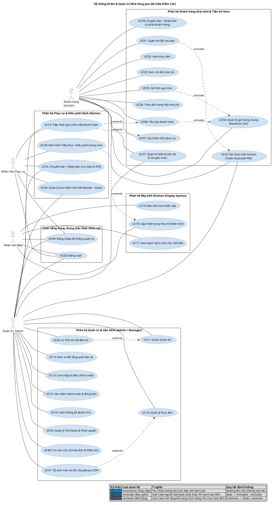
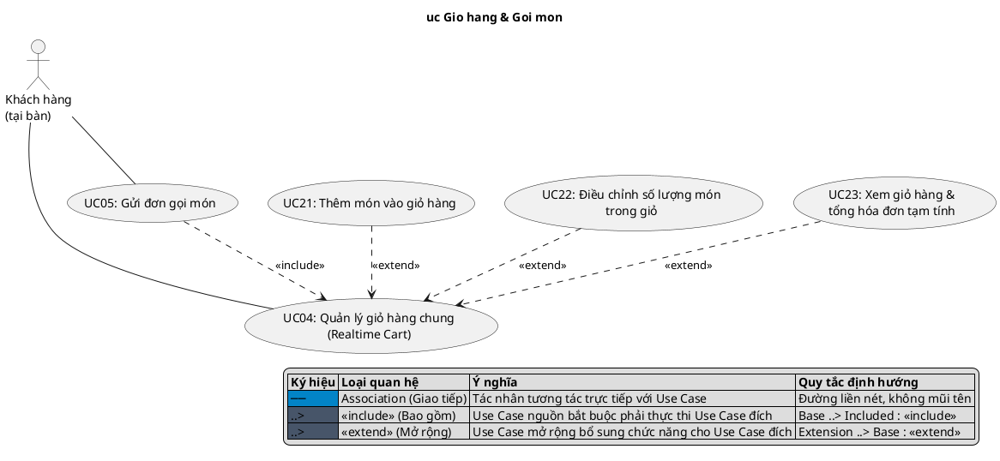
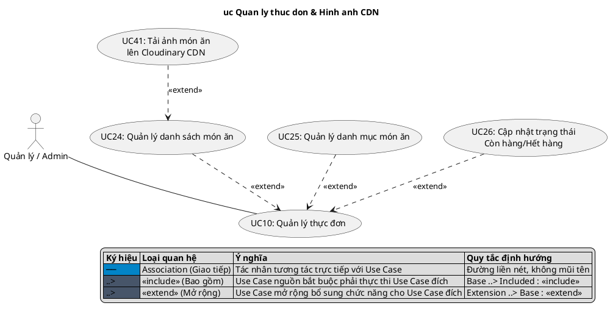
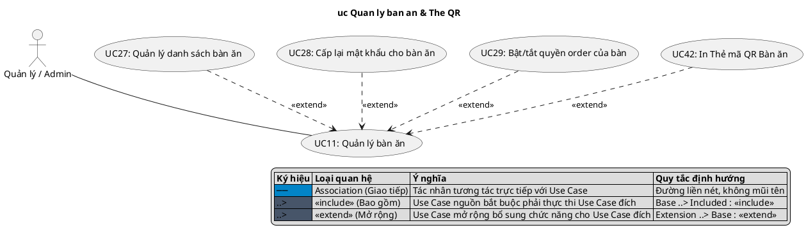
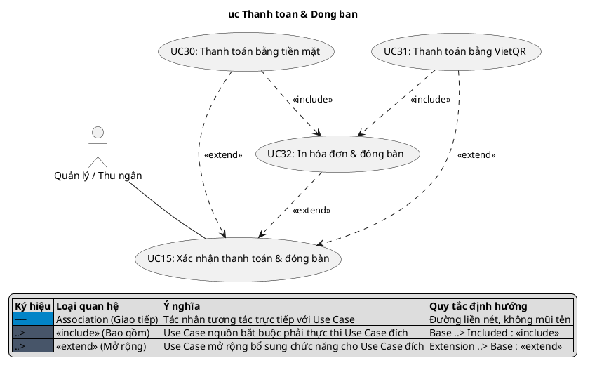
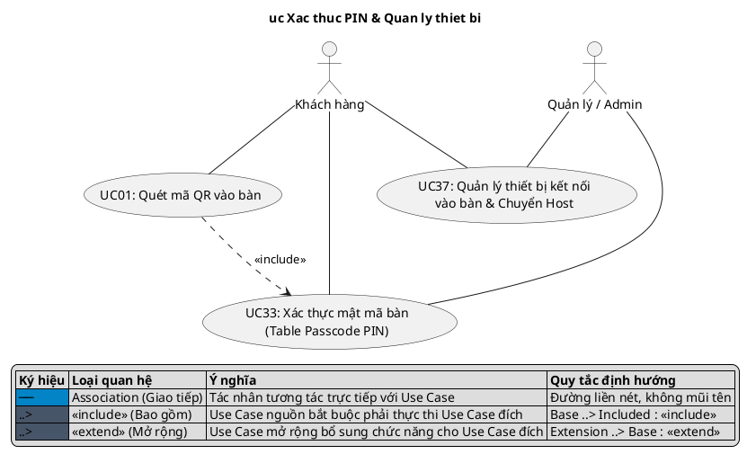
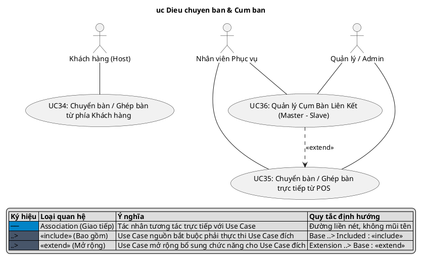
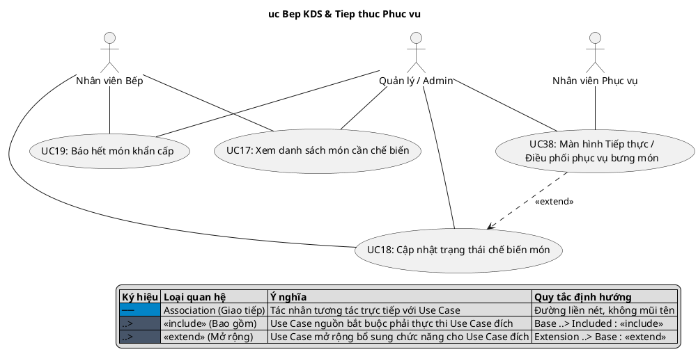
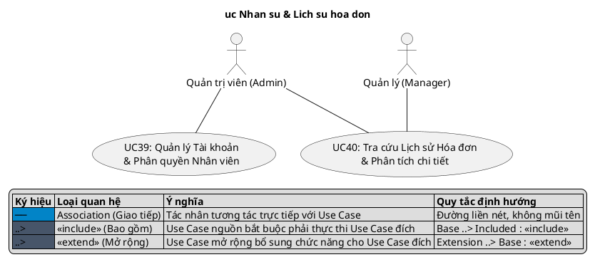

# CHƯƠNG 3: MÔ HÌNH HÓA YÊU CẦU
## Hệ thống Order & Quản trị Nhà hàng qua Mã QR (Hỏa Diễm Các)

> Tài liệu này được chuẩn hóa và cập nhật trực tiếp dựa trên danh mục Use Case mới nhất từ **UC-new.pdf** (gồm 42 Use Case từ UC01 đến UC42), mô hình hóa theo cấu trúc chuẩn: Use Case tổng quát → Lược đồ Use Case chi tiết phân hệ (kèm bảng chú thích) → Đặc tả Use Case chi tiết 13 thành phần. Các lược đồ được cung cấp dưới dạng mã nguồn **PlantUML** trực quan, đồng bộ và có khả năng sinh ảnh tự động.
>
> **4 Nhóm Tác nhân (Actor) chính:**
> 1. **Khách hàng (Customer):** Thực khách tại bàn (quét QR, xác thực mã PIN, xem thực đơn, gọi món, quản lý giỏ hàng chung, theo dõi tiến độ món, gọi phục vụ, yêu cầu thanh toán, chuyển/ghép bàn).
> 2. **Nhân viên Bếp (Kitchen/Bar):** Tiếp nhận đơn gọi món thời gian thực (KDS), cập nhật trạng thái chế biến món (COOKING, SERVED), báo hết món khẩn cấp (SOLD OUT) và mở bán lại (Restock).
> 3. **Nhân viên Phục vụ (Waiter):** Tiếp nhận chuông gọi phục vụ từ khách, màn hình điều phối tiếp thực bưng món đã làm xong (DELIVERED), hỗ trợ chuyển/ghép bàn trực tiếp tại sảnh.
> 4. **Quản trị viên & Quản lý (Admin / Manager):** Quản lý thực đơn, danh mục, tải ảnh CDN, quản lý bàn ăn, in thẻ QR & PIN, xem sơ đồ tổng quát, thu ngân chốt bill (Tiền mặt/VietQR), quản lý tài khoản nhân viên, phân quyền và tra cứu lịch sử hóa đơn doanh thu.

---

## 3.1 Use Case Diagram

### 3.1.1 Use Case tổng quát

**Hình 1: Lược đồ use case tổng quát toàn hệ thống (UC01 - UC42)**

**Bảng 1: Bảng danh mục Use Case tổng quát (Chuẩn hóa theo UC-new.pdf)**

| Mã UC | Tên Use Case | Tác nhân chính | Mô tả chuẩn hóa (theo UC-new.pdf) |
|---|---|---|---|
| **UC01** | Quét mã QR vào bàn | Khách hàng | Khách quét mã QR và nhập mã Passcode PIN 4 số của bàn để xác thực và cấp mã phiên (session_token, device_token), bảo đảm bảo mật trước khi vào menu gọi món. |
| **UC02** | Xem thực đơn | Khách hàng | Khách hàng duyệt thực đơn theo các thẻ danh mục, tìm kiếm món ăn, lọc theo tag (bán chạy, cay, chay...), hiển thị hình ảnh và đơn giá. |
| **UC03** | Xem chi tiết món ăn | Khách hàng | Xem chi tiết từng món ăn gồm ảnh sắc nét, mô tả nguyên liệu, độ cay, giá tiền và trạng thái còn món hay tạm hết. |
| **UC04** | Quản lý giỏ hàng chung (Realtime Cart) | Khách hàng | Giỏ hàng chung đồng bộ thời gian thực giữa mọi thiết bị đang cùng ngồi tại bàn (thêm món, chỉnh số lượng, ghi chú, tính tổng tiền tạm tính). |
| **UC05** | Gửi đơn gọi món | Khách hàng | Khách chốt các món trong giỏ hàng, gửi một đợt gọi món mới (Order Round) vào màn hình POS Bếp, tự động làm rỗng giỏ hàng và phát WebSocket. |
| **UC06** | Theo dõi trạng thái món ăn | Khách hàng | Khách theo dõi danh sách tất cả các đợt gọi món của bàn và tiến độ từng món (Đang chế biến -> Đã phục vụ -> Đã bưng ra bàn / Hết món) cập nhật theo thời gian thực. |
| **UC07** | Gọi nhân viên phục vụ | Khách hàng | Khách bấm chuông gọi nhân viên chọn lý do cụ thể (Xin nước đá, Thêm nước lẩu, Lấy chén đũa, Hỗ trợ khác), gửi thông báo tới Waiter và Manager. |
| **UC08** | Yêu cầu thanh toán | Khách hàng | Khách xem hóa đơn tạm tính và gửi tín hiệu yêu cầu thanh toán về quầy thu ngân / POS quản lý, bàn chuyển sang trạng thái chờ bill (BILL_REQUESTED). |
| **UC09** | Đăng nhập hệ thống quản trị | Quản lý, Nhân viên Bếp, Nhân viên Phục vụ, Quản trị viên | Đăng nhập tài khoản nội bộ (Admin, Manager, Kitchen, Waiter) bằng Email và Mật khẩu, cấp JWT token và điều hướng về phân hệ được phân quyền. |
| **UC10** | Quản lý thực đơn | Quản lý / Admin | Phân hệ toàn diện quản lý món ăn, phân nhóm danh mục và công tắc bật/tắt trạng thái phục vụ còn/hết món. |
| **UC11** | Quản lý bàn ăn | Quản lý / Admin | Quản lý thông tin bàn, thiết lập khu vực, tạo mã QR, cấp lại PIN xoay vòng và khóa/mở quyền gọi món khẩn cấp. |
| **UC12** | Xem sơ đồ tổng quát bàn ăn | Quản lý / Admin | Bản đồ sơ đồ bàn ăn trực quan theo từng khu vực (Tầng trệt, Tầng 1, VIP...), mã màu theo trạng thái (Trống, Đang ăn, Chờ bill, Đang dọn), hiển thị thời lượng ngồi và tiền tạm tính. |
| **UC13** | Can thiệp & điều chỉnh order khách hàng | Quản lý / Admin | Sửa số lượng, đổi món, hủy món trong order của khách khi có sự cố. (Hiện tại mã nguồn chưa triển khai tính năng Quản lý sửa đổi các đợt order đã chốt gửi bếp). |
| **UC14** | Tiếp nhận yêu cầu gọi nhân viên/thanh toán | Nhân viên Phục vụ, Quản lý / Admin | Tiếp nhận chuông báo và xử lý yêu cầu phục vụ / yêu cầu tính tiền từ khách hàng trên màn hình Waiter và sơ đồ bàn Manager/Admin, hỗ trợ đánh dấu đã xử lý xong. |
| **UC15** | Xác nhận thanh toán & đóng bàn | Quản lý / Thu ngân, Admin | Chốt hóa đơn thanh toán cho bàn bằng Tiền mặt hoặc VietQR, tự động đóng phiên bàn, sinh mã PIN mới và chuyển bàn sang trạng thái dọn dẹp. |
| **UC16** | Xem thống kê doanh thu | Quản lý / Admin | Báo cáo doanh thu, chỉ số KPI (doanh thu, số lượt khách, giá trị trung bình đơn), biểu đồ doanh thu theo Ngày/Tuần/Tháng/Năm/Tùy chọn và Top 5 món bán chạy nhất. |
| **UC17** | Xem danh sách món cần chế biến | Nhân viên Bếp, Quản lý | Màn hình POS Bếp (KDS) hiển thị danh sách các đợt gọi món sắp xếp theo chuẩn FIFO, hỗ trợ xem theo từng đợt order hoặc xem tổng hợp (Aggregated View). |
| **UC18** | Cập nhật trạng thái chế biến món | Nhân viên Bếp, Quản lý | Người điều phối ở Bếp cập nhật trạng thái món từ Đang nấu (COOKING) sang Đã chuẩn bị xong (SERVED) cho từng món lẻ hoặc hoàn tất cả đợt gọi. |
| **UC19** | Báo hết món khẩn cấp | Nhân viên Bếp, Quản lý | Bếp KDS báo hết món khẩn cấp: Tự động khóa món trên menu khách hàng (SOLD OUT), tự động gỡ món khỏi tất cả bàn đang đặt và bắn thông báo thời gian thực; có hỗ trợ mở bán lại (restock). |
| **UC20** | Đăng xuất | Quản lý, Nhân viên Bếp, Nhân viên Phục vụ, Quản trị viên | Người dùng nội bộ đăng xuất khỏi tài khoản, hệ thống hủy phiên đăng nhập, xóa JWT trong bộ nhớ/localStorage và đưa về trang Login. |
| **UC33** | Xác thực mật mã bàn (Table Passcode PIN) | Khách hàng, Quản lý / Admin | Khách sau khi quét mã QR bàn phải nhập mã PIN 4 số bảo mật của bàn để được cấp quyền gọi món (tránh quét nhầm hoặc chụp lén QR gọi bậy). Quản lý có thể xem/đổi mã PIN. |
| **UC34** | Chuyển bàn / Ghép bàn từ phía Khách hàng | Khách hàng | Chủ bàn tạo yêu cầu chuyển hoặc ghép bàn (mã xác nhận TTL 5 phút), sang bàn đích nhập mã để chuyển toàn bộ giỏ hàng và đơn đã gọi sang bàn mới. |
| **UC35** | Chuyển bàn / Ghép bàn trực tiếp từ POS | Nhân viên Phục vụ, Quản lý / Admin | Nhân viên hoặc Quản lý thực hiện Chuyển bàn (Move) hoặc Ghép bàn (Merge) trực tiếp trên giao diện POS/Admin mà không cần khách thao tác mã chuyển. |
| **UC36** | Quản lý Cụm Bàn Liên Kết (Master - Slave) | Nhân viên Phục vụ, Quản lý / Admin | Hỗ trợ gộp nhiều bàn phụ (Slave) vào một bàn chính (Master) khi phục vụ các đoàn tiệc đông người; gom hóa đơn về bàn Master và có thể tách bàn phụ (unlink) ra khi cần. |
| **UC37** | Quản lý thiết bị kết nối vào bàn & Chuyển Host | Khách hàng, Quản lý / Admin | Xem danh sách thiết bị đang kết nối vào bàn; Chủ bàn (Host) có thể chuyển quyền Host cho thiết bị khác hoặc kick thiết bị lạ; Quản lý cũng có quyền xem và kick thiết bị từ POS. |
| **UC38** | Màn hình Tiếp thực / Điều phối phục vụ bưng món | Nhân viên Phục vụ, Quản lý | Màn hình chuyên dụng cho nhân viên phục vụ, hiển thị danh sách các món ăn bếp đã làm xong (SERVED) cần bưng ra bàn, hỗ trợ xác nhận đã bưng món (DELIVERED) theo từng món hoặc cả đợt gọi. |
| **UC39** | Quản lý Tài khoản & Phân quyền Nhân viên | Quản trị viên (Admin) | Quản lý toàn bộ nhân viên nhà hàng: Thêm mới, cập nhật thông tin, kích hoạt/khóa tài khoản, cấp lại mật khẩu, phân vai trò (ADMIN, MANAGER, KITCHEN, WAITER, STAFF) và cấu hình chi tiết danh sách quyền hạn module. |
| **UC40** | Tra cứu Lịch sử Hóa đơn & Phân tích chi tiết | Quản lý / Admin | Tra cứu và lọc danh sách hóa đơn theo từ khóa, phương thức thanh toán (Tiền mặt / Chuyển khoản), trạng thái và khoảng ngày; xem chi tiết cơ cấu từng hóa đơn đã thanh toán. |
| **UC41** | Tải ảnh món ăn lên Cloudinary CDN | Quản lý / Admin | Hỗ trợ chọn tệp ảnh trực tiếp từ máy tính khi tạo/sửa món ăn, tải lên Cloudinary CDN và gắn URL ảnh tự động vào thực đơn. |
| **UC42** | In Thẻ mã QR Bàn ăn | Quản lý / Admin | Trang quản lý hiển thị danh sách thẻ bàn kèm QR Code và mã Passcode, hỗ trợ in ấn thẻ lẻ hoặc hàng loạt thẻ theo phân khu để dán lên từng bàn ăn. |

> **Ghi chú danh mục:** Bảng 1 trên đây gồm 30 Use Case chính hiển thị trực tiếp trên Lược đồ Use Case tổng quát (Hình 1). 12 Use Case phân hệ chi tiết còn lại gồm: **UC21 - UC23** (thuộc Lược đồ Giỏ hàng), **UC24 - UC26** (thuộc Lược đồ Thực đơn), **UC27 - UC29** (thuộc Lược đồ Bàn ăn) và **UC30 - UC32** (thuộc Lược đồ Thanh toán) được mô hình hóa và chú thích chi tiết tại các Lược đồ phân hệ tương ứng ở Mục 3.1.2 bên dưới.

**Bảng 1.1: Bảng chú thích các mối quan hệ Use Case tổng quát (<<include>> và <<extend>>)**

| STT | Use Case khởi đầu | Loại quan hệ | Use Case phụ thuộc | Mô tả chi tiết & Điểm mở rộng (Extension Point) |
|:---:|---|:---:|---|---|
| 1 | **UC01: Quét mã QR vào bàn** | `<<include>>` | **UC33: Xác thực mật mã bàn (PIN)** | **Bắt buộc:** Khách quét QR thành công bắt buộc phải xác thực mã Passcode PIN 4 số của bàn để cấp mã phiên (session_token) trước khi vào thực đơn gọi món. |
| 2 | **UC05: Gửi đơn gọi món** | `<<include>>` | **UC04: Quản lý giỏ hàng chung** | **Bắt buộc:** Khi khách gửi một đợt order mới (Order Round) vào bếp, hệ thống bắt buộc truy xuất dữ liệu từ giỏ hàng chung của bàn và làm rỗng giỏ hàng. |
| 3 | **UC08: Yêu cầu thanh toán** | `<<include>>` | **UC04: Quản lý giỏ hàng chung** | **Bắt buộc:** Khi khách bấm yêu cầu thanh toán, hệ thống bắt buộc tổng hợp các món trong giỏ hàng và toàn bộ các đợt gọi trước để kết xuất hóa đơn tạm tính. |
| 4 | **UC14: Tiếp nhận gọi NV/thanh toán** | `<<extend>>` | **UC07: Gọi nhân viên phục vụ** | **Điểm mở rộng:** Màn hình Waiter POS và sơ đồ bàn Quản lý kích hoạt chuông cảnh báo khi khách bấm chuông gọi phục vụ (xin nước đá, chén đũa...). |
| 5 | **UC14: Tiếp nhận gọi NV/thanh toán** | `<<extend>>` | **UC08: Yêu cầu thanh toán** | **Điểm mở rộng:** Màn hình Waiter POS và sơ đồ bàn Quản lý kích hoạt thông báo thanh toán khi khách gửi yêu cầu tính tiền tại bàn. |
| 6 | **UC38: Điều phối tiếp thực bưng món** | `<<extend>>` | **UC18: Cập nhật trạng thái chế biến** | **Điểm mở rộng:** Màn hình tiếp thực phục vụ hiển thị món cần bưng ra bàn ngay khi Bếp chuyển trạng thái món sang "Đã chuẩn bị xong" (`SERVED`). |
| 7 | **UC41: Tải ảnh món ăn lên CDN** | `<<extend>>` | **UC10: Quản lý thực đơn** | **Điểm mở rộng:** Mở rộng tính năng tải tệp ảnh trực tiếp từ máy tính lên Cloudinary CDN khi tạo mới hoặc cập nhật món ăn trong thực đơn. |
| 8 | **UC42: In Thẻ mã QR Bàn ăn** | `<<extend>>` | **UC11: Quản lý bàn ăn** | **Điểm mở rộng:** Mở rộng giao diện quản lý bàn cho phép xem trước và kích hoạt in ấn hàng loạt thẻ tem QR kèm PIN bảo mật để đặt tại bàn. |

---

### 3.1.2 Lược đồ Use Case chi tiết

#### 3.1.2.1 Lược đồ Giỏ hàng & Gọi món (Realtime Cart)

**Hình 2: Lược đồ use case Giỏ hàng & Gọi món**

**Bảng 2: Chú thích Use Case Giỏ hàng & Gọi món**
| Mã UC | Tên Use Case | Tác nhân chính | Mô tả tóm tắt |
|---|---|---|---|
| UC21 | Thêm món vào giỏ hàng | Khách hàng | Chọn món và tùy chỉnh số lượng từ danh sách thực đơn đưa vào giỏ hàng chung của bàn. |
| UC22 | Điều chỉnh số lượng món trong giỏ | Khách hàng | Tăng, giảm số lượng hoặc bấm nút xóa từng món đang chờ gửi bếp trong giỏ hàng chung. |
| UC23 | Xem giỏ hàng & tổng hóa đơn tạm tính | Khách hàng | Mở xem chi tiết các món trong giỏ hàng hiện tại, các món đã gửi qua các đợt gọi trước và tổng tiền tạm tính tương ứng. |
**Bảng 2.1: Bảng chú thích mối quan hệ Giỏ hàng & Gọi món (<<include>> và <<extend>>)**

| STT | Use Case khởi đầu | Loại quan hệ | Use Case phụ thuộc | Mô tả chi tiết & Điểm mở rộng |
|:---:|---|:---:|---|---|
| 1 | **UC21: Thêm món vào giỏ hàng** | `<<extend>>` | **UC04: Quản lý giỏ hàng chung** | Mở rộng hành vi giỏ hàng khi người dùng chọn món từ menu đưa vào giỏ hàng chung của bàn. |
| 2 | **UC22: Điều chỉnh số lượng món** | `<<extend>>` | **UC04: Quản lý giỏ hàng chung** | Mở rộng hành vi giỏ hàng khi người dùng tăng, giảm số lượng hoặc xóa món đang chờ gửi bếp. |
| 3 | **UC23: Xem giỏ hàng & tạm tính** | `<<extend>>` | **UC04: Quản lý giỏ hàng chung** | Mở rộng hành vi giỏ hàng khi người dùng mở drawer xem chi tiết các món và tổng hóa đơn tạm tính. |
| 4 | **UC05: Gửi đơn gọi món** | `<<include>>` | **UC04: Quản lý giỏ hàng chung** | Bắt buộc thực hiện: Đơn gọi món lấy toàn bộ dữ liệu từ giỏ hàng hiện hành và xóa giỏ sau khi gửi thành công. |

---

#### 3.1.2.2 Lược đồ Quản lý thực đơn & Hình ảnh Cloudinary CDN

**Hình 3: Lược đồ use case Quản lý thực đơn**

**Bảng 3: Chú thích Use Case Quản lý thực đơn**
| Mã UC | Tên Use Case | Tác nhân chính | Mô tả tóm tắt |
|---|---|---|---|
| UC24 | Quản lý danh sách món ăn | Quản lý / Admin | Thêm mới, cập nhật giá, mô tả, hình ảnh (upload Cloudinary), thuộc tính danh mục và xóa món ăn khỏi thực đơn. |
| UC25 | Quản lý danh mục món ăn | Quản lý / Admin | Thêm mới, cập nhật tên/mô tả danh mục, bật/tắt hiển thị danh mục và gán món ăn vào danh mục tương ứng. |
| UC26 | Cập nhật trạng thái Còn hàng/Hết hàng | Quản lý / Admin | Toggle bật/tắt nhanh trạng thái còn hàng hoặc hết hàng của món ăn từ trang quản trị thực đơn. |
| UC41 | Tải ảnh món ăn lên Cloudinary CDN | Quản lý / Admin | Hỗ trợ chọn tệp ảnh trực tiếp từ máy tính khi tạo/sửa món ăn, tải lên Cloudinary CDN và gắn URL ảnh tự động vào thực đơn. |
**Bảng 3.1: Bảng chú thích mối quan hệ Quản lý thực đơn (<<extend>>)**

| STT | Use Case khởi đầu | Loại quan hệ | Use Case phụ thuộc | Mô tả chi tiết & Điểm mở rộng |
|:---:|---|:---:|---|---|
| 1 | **UC24: Quản lý danh sách món ăn** | `<<extend>>` | **UC10: Quản lý thực đơn** | Mở rộng chi tiết cho phân hệ thực đơn: Thêm, sửa, xóa thông tin món ăn, đơn giá và mô tả. |
| 2 | **UC25: Quản lý danh mục món ăn** | `<<extend>>` | **UC10: Quản lý thực đơn** | Mở rộng chi tiết cho phân hệ thực đơn: Tạo mới, đổi tên danh mục và phân nhóm món ăn. |
| 3 | **UC26: Cập nhật Còn/Hết hàng** | `<<extend>>` | **UC10: Quản lý thực đơn** | Mở rộng chi tiết cho phân hệ thực đơn: Bật/tắt nhanh trạng thái khả dụng của món ăn. |
| 4 | **UC41: Tải ảnh món ăn lên CDN** | `<<extend>>` | **UC24: Quản lý danh sách món ăn** | Mở rộng khi Quản lý chọn tải tệp ảnh trực tiếp từ máy tính lên đám mây Cloudinary CDN. |

---

#### 3.1.2.3 Lược đồ Quản lý bàn ăn & Thẻ tem mã QR

**Hình 4: Lược đồ use case Quản lý bàn ăn & Thẻ QR**

**Bảng 4: Chú thích Use Case Quản lý bàn ăn**
| Mã UC | Tên Use Case | Tác nhân chính | Mô tả tóm tắt |
|---|---|---|---|
| UC27 | Quản lý danh sách bàn ăn | Quản lý / Admin | Tạo mới bàn, cập nhật tên bàn, khu vực (Tầng trệt, Tầng 1, VIP...), sức chứa chỗ ngồi tối đa. |
| UC28 | Cấp lại mật khẩu cho bàn ăn | Quản lý / Admin | Cấp lại mã mật khẩu PIN 4 số mới và thu hồi token phiên cũ của bàn ăn khi cần xoay vòng bảo mật hoặc nghi lộ mật khẩu, ngắt kết nối thiết bị lạ mà vẫn bảo toàn trạng thái bàn và dữ liệu gọi món. |
| UC29 | Bật/tắt quyền order của bàn | Quản lý / Admin | Khóa hoặc mở khóa quyền gọi món khẩn cấp của bàn (is_order_locked) để tạm dừng hoặc cho phép khách tiếp tục gọi món. |
| UC42 | In Thẻ mã QR Bàn ăn | Quản lý / Admin | Trang quản lý hiển thị danh sách thẻ bàn kèm QR Code và mã Passcode, hỗ trợ in ấn thẻ lẻ hoặc hàng loạt thẻ theo phân khu để dán lên từng bàn ăn. |
**Bảng 4.1: Bảng chú thích mối quan hệ Quản lý bàn ăn (<<extend>>)**

| STT | Use Case khởi đầu | Loại quan hệ | Use Case phụ thuộc | Mô tả chi tiết & Điểm mở rộng |
|:---:|---|:---:|---|---|
| 1 | **UC27: Quản lý danh sách bàn ăn** | `<<extend>>` | **UC11: Quản lý bàn ăn** | Mở rộng chức năng tạo bàn, sửa tên hiển thị, thiết lập phân khu và sức chứa chỗ ngồi. |
| 2 | **UC28: Cấp lại mật khẩu cho bàn** | `<<extend>>` | **UC11: Quản lý bàn ăn** | Mở rộng cấp lại mật khẩu Passcode PIN 4 số mới và thu hồi token khi nghi lộ mật khẩu. |
| 3 | **UC29: Bật/tắt quyền order của bàn** | `<<extend>>` | **UC11: Quản lý bàn ăn** | Mở rộng thao tác khóa hoặc mở khóa khẩn cấp quyền gọi món của bàn (`is_order_locked`). |
| 4 | **UC42: In Thẻ mã QR Bàn ăn** | `<<extend>>` | **UC11: Quản lý bàn ăn** | Mở rộng trang in danh sách thẻ bàn kèm ảnh QR Code và mã PIN 4 số theo phân khu. |

---

#### 3.1.2.4 Lược đồ Thanh toán & Đóng bàn

**Hình 5: Lược đồ use case Thanh toán & Đóng bàn**

**Bảng 5: Chú thích Use Case Thanh toán & Đóng bàn**
| Mã UC | Tên Use Case | Tác nhân chính | Mô tả tóm tắt |
|---|---|---|---|
| UC30 | Thanh toán bằng tiền mặt | Quản lý / Thu ngân, Admin | Chọn thanh toán tiền mặt, nhập tiền khách đưa, tính tiền thừa và xác nhận hoàn tất hóa đơn. |
| UC31 | Thanh toán bằng VietQR | Quản lý / Thu ngân, Admin | Hiển thị mã VietQR động chuẩn Napas247 kèm số tài khoản, số tiền và nội dung hóa đơn để khách quét thanh toán chuyển khoản ngân hàng. |
| UC32 | In hóa đơn & đóng bàn | Quản lý / Thu ngân, Admin | Lưu thông tin hóa đơn vào cơ sở dữ liệu, in hóa đơn nhiệt khổ 80mm cho khách, đóng phiên và chuyển trạng thái bàn sang dọn dẹp (CLEANING). |
**Bảng 5.1: Bảng chú thích mối quan hệ Thanh toán & Đóng bàn (<<include>> và <<extend>>)**

| STT | Use Case khởi đầu | Loại quan hệ | Use Case phụ thuộc | Mô tả chi tiết & Điểm mở rộng |
|:---:|---|:---:|---|---|
| 1 | **UC30: Thanh toán bằng tiền mặt** | `<<extend>>` | **UC15: Xác nhận thanh toán & đóng bàn** | Lựa chọn phương thức thanh toán tiền mặt tại quầy thu ngân, tính tiền thừa cho khách. |
| 2 | **UC31: Thanh toán bằng VietQR** | `<<extend>>` | **UC15: Xác nhận thanh toán & đóng bàn** | Lựa chọn phương thức thanh toán chuyển khoản qua mã VietQR động chuẩn Napas247. |
| 3 | **UC32: In hóa đơn & đóng bàn** | `<<extend>>` | **UC15: Xác nhận thanh toán & đóng bàn** | Bước hoàn tất chốt thanh toán, in bill nhiệt khổ 80mm và chuyển trạng thái bàn sang dọn dẹp. |
| 4 | **UC30: Thanh toán bằng tiền mặt** | `<<include>>` | **UC32: In hóa đơn & đóng bàn** | Bắt buộc thực hiện: Khi nhận đủ tiền mặt từ khách, hệ thống bắt buộc in hóa đơn và đóng bàn. |
| 5 | **UC31: Thanh toán bằng VietQR** | `<<include>>` | **UC32: In hóa đơn & đóng bàn** | Bắt buộc thực hiện: Khi nhận được thanh toán chuyển khoản, hệ thống bắt buộc in hóa đơn và đóng bàn. |

---

#### 3.1.2.5 Lược đồ Xác thực PIN & Quản lý thiết bị phiên bàn ăn

**Hình 6: Lược đồ use case Xác thực PIN & Quản lý thiết bị**

**Bảng 6: Chú thích Use Case Xác thực PIN & Thiết bị**
| Mã UC | Tên Use Case | Tác nhân chính | Mô tả tóm tắt |
|---|---|---|---|
| UC33 | Xác thực mật mã bàn (Table Passcode PIN) | Khách hàng, Quản lý / Admin | Khách sau khi quét mã QR bàn phải nhập mã PIN 4 số bảo mật của bàn để được cấp quyền gọi món (tránh quét nhầm hoặc chụp lén QR gọi bậy). Quản lý có thể xem/đổi mã PIN. |
| UC37 | Quản lý thiết bị kết nối vào bàn & Chuyển Host | Khách hàng, Quản lý / Admin | Xem danh sách thiết bị đang kết nối vào bàn; Chủ bàn (Host) có thể chuyển quyền Host cho thiết bị khác hoặc kick thiết bị lạ; Quản lý cũng có quyền xem và kick thiết bị từ POS. |
**Bảng 6.1: Bảng chú thích mối quan hệ Xác thực PIN & Thiết bị (<<include>>)**

| STT | Use Case khởi đầu | Loại quan hệ | Use Case phụ thuộc | Mô tả chi tiết & Điểm mở rộng |
|:---:|---|:---:|---|---|
| 1 | **UC01: Quét mã QR vào bàn** | `<<include>>` | **UC33: Xác thực mật mã bàn (PIN)** | Bắt buộc thực hiện: Thiết bị sau khi quét QR bàn bắt buộc phải nhập đúng mã PIN 4 số bảo mật của bàn để được cấp quyền gọi món. |

---

#### 3.1.2.6 Lược đồ Điều chuyển bàn, Ghép bàn & Cụm bàn liên kết

**Hình 7: Lược đồ use case Điều chuyển & Cụm bàn liên kết**

**Bảng 7: Chú thích Use Case Điều chuyển & Cụm bàn liên kết**
| Mã UC | Tên Use Case | Tác nhân chính | Mô tả tóm tắt |
|---|---|---|---|
| UC34 | Chuyển bàn / Ghép bàn từ phía Khách hàng | Khách hàng | Chủ bàn tạo yêu cầu chuyển hoặc ghép bàn (mã xác nhận TTL 5 phút), sang bàn đích nhập mã để chuyển toàn bộ giỏ hàng và đơn đã gọi sang bàn mới. |
| UC35 | Chuyển bàn / Ghép bàn trực tiếp từ POS | Nhân viên Phục vụ, Quản lý / Admin | Nhân viên hoặc Quản lý thực hiện Chuyển bàn (Move) hoặc Ghép bàn (Merge) trực tiếp trên giao diện POS/Admin mà không cần khách thao tác mã chuyển. |
| UC36 | Quản lý Cụm Bàn Liên Kết (Master - Slave) | Nhân viên Phục vụ, Quản lý / Admin | Hỗ trợ gộp nhiều bàn phụ (Slave) vào một bàn chính (Master) khi phục vụ các đoàn tiệc đông người; gom hóa đơn về bàn Master và có thể tách bàn phụ (unlink) ra khi cần. |
**Bảng 7.1: Bảng chú thích mối quan hệ Điều chuyển & Cụm bàn (<<extend>>)**

| STT | Use Case khởi đầu | Loại quan hệ | Use Case phụ thuộc | Mô tả chi tiết & Điểm mở rộng |
|:---:|---|:---:|---|---|
| 1 | **UC36: Quản lý Cụm Bàn Liên Kết** | `<<extend>>` | **UC35: Chuyển/Ghép bàn từ POS** | Mở rộng tính năng ghép bàn cơ bản thành cơ chế Cụm bàn Master - Slave cho các đoàn tiệc lớn. |

---

#### 3.1.2.7 Lược đồ Bếp KDS & Màn hình Tiếp thực Phục vụ

**Hình 8: Lược đồ use case Bếp KDS & Màn hình Phục vụ**

**Bảng 8: Chú thích Use Case Bếp KDS & Phục vụ**
| Mã UC | Tên Use Case | Tác nhân chính | Mô tả tóm tắt |
|---|---|---|---|
| UC17 | Xem danh sách món cần chế biến | Nhân viên Bếp, Quản lý | Màn hình POS Bếp (KDS) hiển thị danh sách các đợt gọi món sắp xếp theo chuẩn FIFO, hỗ trợ xem theo từng đợt order hoặc xem tổng hợp (Aggregated View). |
| UC18 | Cập nhật trạng thái chế biến món | Nhân viên Bếp, Quản lý | Người điều phối ở Bếp cập nhật trạng thái món từ Đang nấu (COOKING) sang Đã chuẩn bị xong (SERVED) cho từng món lẻ hoặc hoàn tất cả đợt gọi. |
| UC19 | Báo hết món khẩn cấp | Nhân viên Bếp, Quản lý | Bếp KDS báo hết món khẩn cấp: Tự động khóa món trên menu khách hàng (SOLD OUT), tự động gỡ món khỏi tất cả bàn đang đặt và bắn thông báo thời gian thực; có hỗ trợ mở bán lại (restock). |
| UC38 | Màn hình Tiếp thực / Điều phối phục vụ bưng món | Nhân viên Phục vụ, Quản lý | Màn hình chuyên dụng cho nhân viên phục vụ, hiển thị danh sách các món ăn bếp đã làm xong (SERVED) cần bưng ra bàn, hỗ trợ xác nhận đã bưng món (DELIVERED) theo từng món hoặc cả đợt gọi. |
**Bảng 8.1: Bảng chú thích mối quan hệ Bếp KDS & Tiếp thực (<<extend>>)**

| STT | Use Case khởi đầu | Loại quan hệ | Use Case phụ thuộc | Mô tả chi tiết & Điểm mở rộng |
|:---:|---|:---:|---|---|
| 1 | **UC38: Điều phối tiếp thực bưng món** | `<<extend>>` | **UC18: Cập nhật trạng thái chế biến** | Mở rộng quy trình: Màn hình tiếp thực phục vụ hiển thị món cần bưng ra bàn ngay khi Bếp chuyển trạng thái món sang "Đã chuẩn bị xong" (`SERVED`). |

---

#### 3.1.2.8 Lược đồ Quản trị nhân sự & Tra cứu Lịch sử hóa đơn

**Hình 9: Lược đồ use case Quản trị nhân sự & Lịch sử hóa đơn**

**Bảng 9: Chú thích Use Case Quản trị nhân sự & Lịch sử hóa đơn**
| Mã UC | Tên Use Case | Tác nhân chính | Mô tả tóm tắt |
|---|---|---|---|
| UC39 | Quản lý Tài khoản & Phân quyền Nhân viên | Quản trị viên (Admin) | Quản lý toàn bộ nhân viên nhà hàng: Thêm mới, cập nhật thông tin, kích hoạt/khóa tài khoản, cấp lại mật khẩu, phân vai trò (ADMIN, MANAGER, KITCHEN, WAITER, STAFF) và cấu hình chi tiết danh sách quyền hạn module. |
| UC40 | Tra cứu Lịch sử Hóa đơn & Phân tích chi tiết | Quản lý / Admin | Tra cứu và lọc danh sách hóa đơn theo từ khóa, phương thức thanh toán (Tiền mặt / Chuyển khoản), trạng thái và khoảng ngày; xem chi tiết cơ cấu từng hóa đơn đã thanh toán. |

---

## 3.2 Đặc tả Use Case Chi Tiết (UC01 – UC42)

### 3.2.1 UC01: Quét mã QR vào bàn

| Thành phần | Nội dung |
|---|---|
| Use Case ID | UC01 |
| Use Case Name | Quét mã QR vào bàn |
| Relationships (Quan hệ) | <<include>> UC33 (Xác thực mật mã bàn Table Passcode PIN) |
| Description | Khách quét mã QR và nhập mã Passcode PIN 4 số của bàn để xác thực và cấp mã phiên (session_token, device_token), bảo đảm bảo mật trước khi vào menu gọi món. |
| Tác nhân (Actor) | Khách hàng |
| Priority | Must have |
| Trigger | Khách hàng dùng camera điện thoại quét mã QR dán tại bàn. |
| Pre-Condition(s) | Mã QR của bàn còn hiệu lực (chưa bị thu hồi). Bàn đang mở phiên phục vụ. |
| Post-Condition(s) | Trình duyệt được xác thực đúng bàn qua session_token; điều hướng tới trang nhập mã PIN (UC33) trước khi mở thực đơn (UC02). |
| Basic Flow | 1. Khách hàng quét mã QR, mã chứa URL dạng `https://domain.com/table/{id}`. 2. Trình duyệt mở trang chào mừng của bàn, gửi yêu cầu xác thực phiên bàn với server. 3. Server đối chiếu và kiểm tra trạng thái bàn. 4. Nếu bàn ở trạng thái "Bàn trống" (AVAILABLE), hệ thống chuyển sang "Đang ăn" (OCCUPIED). 5. Hệ thống yêu cầu khách hàng nhập mã PIN 4 số của bàn để xác thực thiết bị (chuyển tiếp sang UC33). |
| Alternative Flow | 4a. Nếu bàn đã ở trạng thái "Đang ăn" (OCCUPIED), hệ thống cho phép thiết bị mới tham gia vào phiên bàn sau khi nhập đúng mã PIN 4 số. |
| Exception Flow | 3a. Mã QR không hợp lệ hoặc đã bị thu hồi. - 3a1. Hệ thống báo lỗi "Mã QR bàn không còn hiệu lực. Vui lòng liên hệ nhân viên!". - Use Case dừng lại. |
| Business Rules | - BR01.1: Mã QR gắn liền với bàn vật lý và phiên phục vụ duy nhất. |
| Non-Functional Requirement | - NFR01.1: Thời gian phản hồi điều hướng sau khi quét QR dưới 1.5 giây. |

---

### 3.2.2 UC02: Xem thực đơn

| Thành phần | Nội dung |
|---|---|
| Use Case ID | UC02 |
| Use Case Name | Xem thực đơn |
| Relationships (Quan hệ) | Được mở rộng bởi UC03 (<<extend>>) |
| Description | Khách hàng duyệt thực đơn theo các thẻ danh mục, tìm kiếm món ăn, lọc theo tag (bán chạy, cay, chay...), hiển thị hình ảnh và đơn giá. |
| Tác nhân (Actor) | Khách hàng |
| Priority | Must have |
| Trigger | Khách hàng vào trang thực đơn sau khi xác thực mã PIN thành công. |
| Pre-Condition(s) | Thiết bị đã xác thực phiên bàn hợp lệ (qua UC01 và UC33). |
| Post-Condition(s) | Danh sách món ăn hiển thị đầy đủ kèm hình ảnh, tên, đơn giá VNĐ, mô tả và trạng thái Còn hàng / Hết hàng. |
| Basic Flow | 1. Khách hàng truy cập trang thực đơn `/table/:tableId/menu`. 2. Hệ thống tải danh mục và danh sách món ăn từ Database. 3. Khách hàng cuộn danh sách (ScrollSpy 2 chiều) hoặc bấm vào các thẻ danh mục (Bán chạy, Lẩu, Bò & Thịt, Hải sản, Đồ uống...). 4. Khách hàng có thể nhập từ khóa vào thanh tìm kiếm hoặc lọc theo tag. |
| Alternative Flow | 3a. Khách hàng bấm chọn tag "Bán Chạy" / "Đặc sắc", hệ thống hiển thị danh sách các món nổi bật được gắn cờ. |
| Exception Flow | 2a. Mất kết nối server: Hệ thống hiển thị thông báo lỗi mạng và nút "Thử lại". |
| Business Rules | - BR02.1: Món ăn ở trạng thái Tạm khóa (Hết hàng) phải hiển thị nhãn SOLD OUT và khóa nút thêm món. |
| Non-Functional Requirement | - NFR02.1: Giao diện tối ưu cuộn mượt mà trên thiết bị di động (Mobile Responsive). |

---

### 3.2.3 UC03: Xem chi tiết món ăn

| Thành phần | Nội dung |
|---|---|
| Use Case ID | UC03 |
| Use Case Name | Xem chi tiết món ăn |
| Relationships (Quan hệ) | <<extend>> UC02 (Xem chi tiết từ danh sách món trong thực đơn) |
| Description | Xem chi tiết từng món ăn gồm ảnh sắc nét, mô tả nguyên liệu, độ cay, giá tiền và trạng thái còn món hay tạm hết. |
| Tác nhân (Actor) | Khách hàng |
| Priority | Should have |
| Trigger | Khách hàng nhấn vào thẻ món ăn trên danh sách thực đơn. |
| Pre-Condition(s) | Đang ở giao diện thực đơn (UC02). |
| Post-Condition(s) | Modal chi tiết món ăn mở ra, hiển thị đầy đủ thông tin chuyên sâu. |
| Basic Flow | 1. Khách hàng chạm vào món ăn cần xem. 2. Modal hiển thị ảnh chất lượng cao, mô tả nguyên liệu chi tiết, độ cay, mức giá và trạng thái phục vụ. 3. Khách hàng có thể tùy chỉnh số lượng và bấm "Thêm vào giỏ hàng" trực tiếp từ modal (UC21). |
| Alternative Flow | 3a. Khách hàng tùy chỉnh số lượng, ghi chú món ăn (không hành, ít cay...) và bấm "Thêm vào giỏ hàng" trực tiếp từ modal. |
| Exception Flow | 2a. Món ăn vừa chuyển sang hết hàng trong lúc mở modal: Hệ thống tự động vô hiệu hóa nút thêm món. |
| Business Rules | - BR03.1: Ảnh món tải từ link Cloudinary CDN tối ưu hóa độ phân giải. |
| Non-Functional Requirement | - NFR03.1: Thời gian mở modal chi tiết dưới 200ms. |

---

### 3.2.4 UC04: Quản lý giỏ hàng chung (Realtime Cart)

| Thành phần | Nội dung |
|---|---|
| Use Case ID | UC04 |
| Use Case Name | Quản lý giỏ hàng chung (Realtime Cart) |
| Relationships (Quan hệ) | Được mở rộng bởi UC21, UC22, UC23 (<<extend>>); Được bao gồm bởi UC05, UC08 (<<include>>) |
| Description | Giỏ hàng chung đồng bộ thời gian thực giữa mọi thiết bị đang cùng ngồi tại bàn (thêm món, chỉnh số lượng, ghi chú, tính tổng tiền tạm tính). |
| Tác nhân (Actor) | Khách hàng |
| Priority | Must have |
| Trigger | Khách hàng thực hiện bất kỳ thao tác nào lên giỏ hàng (thêm, sửa, xóa, ghi chú). |
| Pre-Condition(s) | Thiết bị đang trong phiên bàn hợp lệ. |
| Post-Condition(s) | Giỏ hàng chung của cả bàn được cập nhật và đồng bộ tức thời 0ms tới tất cả các thiết bị đang kết nối. |
| Basic Flow | 1. Khách hàng thao tác trên giỏ hàng tại thiết bị cá nhân. 2. Hệ thống lưu thay đổi và phát thông điệp đồng bộ qua kênh WebSocket `/topic/table/{tableNumber}/cart` hoặc BroadcastChannel. 3. Mọi thiết bị khác trong bàn tự động cập nhật giỏ hàng tương ứng mà không cần tải lại trang. |
| Alternative Flow | 1a. Một thành viên khác trong bàn thêm/sửa/xóa món: Giỏ hàng trên máy khách tự động cập nhật đồng bộ tức thì 0ms qua kênh WebSocket `/topic/table/{sessionToken}/cart`. |
| Exception Flow | 2a. Mất kết nối mạng: Hệ thống hiển thị cảnh báo offline và tự động tái kết nối khi mạng phục hồi. |
| Business Rules | - BR04.1: Giỏ hàng chung chỉ chứa các món đang chờ gửi bếp (đơn nháp). |
| Non-Functional Requirement | - NFR04.1: Độ trễ đồng bộ giỏ hàng giữa các thiết bị dưới 500ms. |

---

### 3.2.5 UC05: Gửi đơn gọi món

| Thành phần | Nội dung |
|---|---|
| Use Case ID | UC05 |
| Use Case Name | Gửi đơn gọi món |
| Relationships (Quan hệ) | <<include>> UC04 (Truy xuất danh sách món từ giỏ hàng chung) |
| Description | Khách chốt các món trong giỏ hàng, gửi một đợt gọi món mới (Order Round) vào màn hình POS Bếp, tự động làm rỗng giỏ hàng và phát WebSocket. |
| Tác nhân (Actor) | Khách hàng |
| Priority | Must have |
| Trigger | Khách hàng (Chủ Bàn hoặc thành viên có quyền) nhấn nút "Gửi đơn vào bếp". |
| Pre-Condition(s) | Giỏ hàng có ít nhất 1 món ăn; quyền gọi món của bàn không bị khóa (`is_order_locked = false`). |
| Post-Condition(s) | Một Order Round mới được tạo, chuyển vào màn hình Bếp KDS; giỏ hàng chung của bàn được làm rỗng. |
| Basic Flow | 1. Khách hàng kiểm tra giỏ hàng và nhấn nút "Gửi đơn vào bếp". 2. Hệ thống kiểm tra hợp lệ: món còn hàng và bàn không bị khóa order. 3. Hệ thống tạo Order Round mới với mã đợt gọi và danh sách món ăn, gán trạng thái ban đầu là Đang nấu (`COOKING`). 4. Hệ thống phát WebSocket tới kênh `/topic/kitchen/orders` kèm âm thanh chuông báo. 5. Giỏ hàng chung được xóa rỗng và giao diện khách chuyển sang theo dõi tiến độ món (UC06). |
| Alternative Flow | 1a. Khách hàng có thể tiếp tục chọn món và gửi các đợt gọi món tiếp theo (Đợt 2, Đợt 3...) trong suốt bữa ăn mà không bị giới hạn số lần. |
| Exception Flow | 2a. Bàn đang bị khóa order (`is_order_locked = true`): Hệ thống từ chối và báo lỗi: *"Bàn ăn hiện đang tạm khóa order. Vui lòng liên hệ nhân viên!"*. 2b. Một món trong giỏ vừa hết hàng: Hệ thống thông báo món hết hàng và yêu cầu xác nhận gỡ bỏ món trước khi gửi tiếp. |
| Business Rules | - BR05.1: Đơn gọi món một khi đã gửi bếp sẽ không thể tự ý hủy từ phía khách hàng (phải qua nhân viên can thiệp). |
| Non-Functional Requirement | - NFR05.1: Màn hình Bếp KDS nhận được đơn mới trong vòng dưới 1 giây. |

---

### 3.2.6 UC06: Theo dõi trạng thái món ăn

| Thành phần | Nội dung |
|---|---|
| Use Case ID | UC06 |
| Use Case Name | Theo dõi trạng thái món ăn |
| Relationships (Quan hệ) | Không có (Độc lập) |
| Description | Khách theo dõi danh sách tất cả các đợt gọi món của bàn và tiến độ từng món (Đang chế biến -> Đã phục vụ -> Đã bưng ra bàn / Hết món) cập nhật theo thời gian thực. |
| Tác nhân (Actor) | Khách hàng |
| Priority | High |
| Trigger | Khách hàng mở tab "Đơn đã gọi" trên thanh giỏ hàng hoặc điều hướng. |
| Pre-Condition(s) | Bàn đã gửi ít nhất một đợt gọi món (UC05). |
| Post-Condition(s) | Màn hình hiển thị chi tiết từng đợt order kèm trạng thái thời gian thực của từng món ăn. |
| Basic Flow | 1. Khách hàng mở tab "Đơn đã gọi". 2. Hệ thống hiển thị danh sách các đợt gọi món (Đợt 1, Đợt 2...). 3. Khi Bếp hoặc Phục vụ cập nhật tiến độ (COOKING -> SERVED -> DELIVERED), giao diện khách hàng tự động cập nhật thanh tiến độ và màu sắc tương ứng theo thời gian thực. |
| Alternative Flow | 3a. Khách bấm nút "Làm mới đơn" để tải lại tiến độ món nếu mạng chập chờn. |
| Exception Flow | 3a. Món ăn bị Bếp báo hủy do hết nguyên liệu: Thẻ món chuyển sang trạng thái ĐÃ HỦY kèm lý do thông báo cho khách. |
| Business Rules | - BR06.1: Trạng thái món cập nhật qua WebSocket STOMP bảo đảm tính tức thời. |
| Non-Functional Requirement | - NFR06.1: Không yêu cầu người dùng phải bấm F5 để xem tiến độ mới. |

---

### 3.2.7 UC07: Gọi nhân viên phục vụ

| Thành phần | Nội dung |
|---|---|
| Use Case ID | UC07 |
| Use Case Name | Gọi nhân viên phục vụ |
| Relationships (Quan hệ) | Được mở rộng bởi UC14 (<<extend>> Tiếp nhận yêu cầu phục vụ) |
| Description | Khách bấm chuông gọi nhân viên chọn lý do cụ thể (Xin nước đá, Thêm nước lẩu, Lấy chén đũa, Hỗ trợ khác), gửi thông báo tới Waiter và Manager. |
| Tác nhân (Actor) | Khách hàng |
| Priority | High |
| Trigger | Khách hàng nhấn nút chuông "Gọi nhân viên" trên giao diện. |
| Pre-Condition(s) | Thiết bị đang trong phiên bàn hợp lệ. |
| Post-Condition(s) | Thông báo chuông kèm số bàn và lý do được phát tới màn hình Waiter và Admin. |
| Basic Flow | 1. Khách hàng nhấn biểu tượng chuông gọi nhân viên. 2. Chọn lý do cần hỗ trợ: "Xin nước đá", "Thêm nước lẩu", "Lấy thêm chén dĩa", hoặc "Hỗ trợ khác". 3. Nhấn "Xác nhận gửi gọi". 4. Hệ thống ghi nhận yêu cầu và bắn WebSocket tới màn hình nhân viên phục vụ (`/topic/waiter/alerts`) kèm âm thanh cảnh báo. 5. Màn hình khách hàng hiển thị thông báo: *"Đã gọi nhân viên thành công. Nhân viên sẽ tới ngay!"*. |
| Alternative Flow | 2a. Khách hàng nhập nội dung yêu cầu cụ thể tại ô "Hỗ trợ khác" (VD: "Xin ghế em bé", "Thêm quạt gió"). |
| Exception Flow | 4a. Khách bấm liên tục: Hệ thống kích hoạt cơ chế giới hạn tần suất (Rate Limiting) chặn bấm lặp lại trong vòng 30 giây. |
| Business Rules | - BR07.1: Chỉ cho phép gửi lại yêu cầu mới sau khoảng thời gian đệm an toàn. |
| Non-Functional Requirement | - NFR07.1: Âm thanh thông báo bên phía nhân viên phải rõ ràng, thu hút sự chú ý. |

---

### 3.2.8 UC08: Yêu cầu thanh toán

| Thành phần | Nội dung |
|---|---|
| Use Case ID | UC08 |
| Use Case Name | Yêu cầu thanh toán |
| Relationships (Quan hệ) | <<include>> UC04 (Tổng hợp hóa đơn tạm tính); Được mở rộng bởi UC14 (<<extend>> Tiếp nhận tính tiền) |
| Description | Khách xem hóa đơn tạm tính và gửi tín hiệu yêu cầu thanh toán về quầy thu ngân / POS quản lý, bàn chuyển sang trạng thái chờ bill (BILL_REQUESTED). |
| Tác nhân (Actor) | Khách hàng |
| Priority | Must have |
| Trigger | Khách hàng nhấn nút "Yêu cầu thanh toán" sau khi dùng bữa xong. |
| Pre-Condition(s) | Bàn đã có ít nhất một đợt gọi món hoàn tất. |
| Post-Condition(s) | Bàn chuyển trạng thái sang Chờ thanh toán (`BILL_REQUESTED`); thu ngân nhận cảnh báo chốt bill. |
| Basic Flow | 1. Khách hàng mở bảng tổng kết hóa đơn tạm tính. 2. Nhấn nút "Yêu cầu thanh toán" và chọn phương thức mong muốn (Tiền mặt hoặc Chuyển khoản). 3. Hệ thống cập nhật trạng thái bàn sang `BILL_REQUESTED` và khóa cờ order bàn. 4. Server phát thông điệp cảnh báo tới quầy thu ngân và nhân viên phục vụ. 5. Màn hình khách hàng chuyển sang chế độ chờ đối soát và hiển thị thông điệp chờ nhân viên tới hỗ trợ. |
| Alternative Flow | 2a. Khách hàng lựa chọn trước phương thức thanh toán mong muốn (Tiền mặt hoặc VietQR) để thu ngân chuẩn bị hóa đơn tương ứng. |
| Exception Flow | 1a. Bàn chưa gọi món nào: Nút yêu cầu thanh toán bị vô hiệu hóa. |
| Business Rules | - BR08.1: Khi bàn chuyển sang `BILL_REQUESTED`, khách hàng không thể tự ý gọi thêm món nếu chưa được mở khóa. |
| Non-Functional Requirement | - NFR08.1: Tổng tiền hiển thị trên màn hình khách phải khớp 100% với số liệu tại quầy POS. |

---

### 3.2.9 UC09: Đăng nhập hệ thống quản trị

| Thành phần | Nội dung |
|---|---|
| Use Case ID | UC09 |
| Use Case Name | Đăng nhập hệ thống quản trị |
| Relationships (Quan hệ) | Không có (Độc lập) |
| Description | Đăng nhập tài khoản nội bộ (Admin, Manager, Kitchen, Waiter) bằng Email và Mật khẩu, cấp JWT token và điều hướng về phân hệ được phân quyền. |
| Tác nhân (Actor) | Quản lý, Nhân viên Bếp, Nhân viên Phục vụ, Quản trị viên |
| Priority | Must have |
| Trigger | Nhân sự truy cập trang đăng nhập nội bộ `/login`. |
| Pre-Condition(s) | Tài khoản nhân sự đã được tạo trong cơ sở dữ liệu và đang ở trạng thái kích hoạt (`ACTIVE`). |
| Post-Condition(s) | Cấp cặp JWT Token (Access Token & Refresh Token), lưu vào cookie/storage và điều hướng về đúng trang chức năng tương ứng. |
| Basic Flow | 1. Người dùng nhập Email và Mật khẩu vào form đăng nhập. 2. Nhấn nút "Đăng nhập". 3. Hệ thống xác thực mật khẩu qua mã băm BCrypt và kiểm tra trạng thái tài khoản. 4. Tạo chuỗi JWT Token chứa thông tin định danh và danh sách quyền hạn (Roles/Authorities). 5. Hệ thống điều hướng: Admin/Manager vào `/admin`, Bếp vào `/kitchen`, Phục vụ vào `/waiter`. |
| Alternative Flow | 5a. Hệ thống phân quyền điều hướng linh hoạt: Admin và Manager vào Dashboard quản trị, Đầu bếp vào KDS Bếp, Phục vụ vào màn hình Tiếp thực. |
| Exception Flow | 3a. Nhập sai email hoặc mật khẩu: Báo lỗi *"Tài khoản hoặc mật khẩu không chính xác!"*. 3b. Tài khoản bị tạm khóa (`INACTIVE`): Báo lỗi *"Tài khoản đã bị tạm khóa. Vui lòng liên hệ Quản trị viên!"*. |
| Business Rules | - BR09.1: Áp dụng cơ chế phân quyền RBAC nghiêm ngặt tại tầng Spring Security và React Route Guards. |
| Non-Functional Requirement | - NFR09.1: Thời gian xử lý đăng nhập dưới 1 giây. Mật khẩu không bao giờ lưu dưới dạng văn bản thô. |

---

### 3.2.10 UC10: Quản lý thực đơn

| Thành phần | Nội dung |
|---|---|
| Use Case ID | UC10 |
| Use Case Name | Quản lý thực đơn |
| Relationships (Quan hệ) | Được mở rộng bởi UC24, UC25, UC26, UC41 (<<extend>>) |
| Description | Phân hệ toàn diện quản lý món ăn, phân nhóm danh mục và công tắc bật/tắt trạng thái phục vụ còn/hết món. |
| Tác nhân (Actor) | Quản lý / Admin |
| Priority | Must have |
| Trigger | Quản lý chọn mục "Thực đơn" trên menu điều hướng quản trị. |
| Pre-Condition(s) | Đã đăng nhập tài khoản có quyền Quản lý thực đơn (`MENU_MANAGE`). |
| Post-Condition(s) | Giao diện quản lý thực đơn hiển thị danh sách món, danh mục, thanh thống kê và các bộ lọc nghiệp vụ. |
| Basic Flow | 1. Quản lý truy cập trang `/admin/menu`. 2. Hệ thống tải toàn bộ danh sách món ăn và danh mục từ Database. 3. Hiển thị thanh tóm tắt số lượng món (Tổng số, Đang bán, Tạm khóa). 4. Quản lý thực hiện các chức năng con: UC24 (Quản lý món), UC25 (Quản lý danh mục), UC26 (Cập nhật trạng thái) và UC41 (Tải ảnh CDN). |
| Alternative Flow | 4a. Quản lý sử dụng thanh tìm kiếm nhanh theo tên món hoặc lọc danh sách theo từng danh mục cụ thể. |
| Exception Flow | 2a. Lỗi tải dữ liệu: Hiển thị thông báo cảnh báo và cho phép bấm "Tải lại dữ liệu". |
| Business Rules | - BR10.1: Mọi thay đổi về món ăn và trạng thái được đồng bộ thời gian thực sang phía khách hàng. |
| Non-Functional Requirement | - NFR10.1: Hỗ trợ tìm kiếm nhanh, lọc theo danh mục và phân trang mượt mà. |

---

### 3.2.11 UC11: Quản lý bàn ăn

| Thành phần | Nội dung |
|---|---|
| Use Case ID | UC11 |
| Use Case Name | Quản lý bàn ăn |
| Relationships (Quan hệ) | Được mở rộng bởi UC27, UC28, UC29, UC42 (<<extend>>) |
| Description | Quản lý thông tin bàn, thiết lập khu vực, tạo mã QR, cấp lại PIN xoay vòng và khóa/mở quyền gọi món khẩn cấp. |
| Tác nhân (Actor) | Quản lý / Admin |
| Priority | Must have |
| Trigger | Quản lý chọn mục "Quản lý bàn" trên thanh điều hướng. |
| Pre-Condition(s) | Đã đăng nhập tài khoản có quyền Quản lý bàn (`TABLE_MANAGE`). |
| Post-Condition(s) | Bảng danh sách bàn hiển thị đầy đủ trạng thái, khu vực, mã PIN, mã QR và cờ khóa order. |
| Basic Flow | 1. Quản lý mở trang `/admin/tables`. 2. Hệ thống hiển thị danh sách toàn bộ các bàn trong nhà hàng. 3. Quản lý thực hiện các chức năng con: UC27 (Quản lý danh sách bàn ăn), UC28 (Cấp lại mật khẩu cho bàn ăn), UC29 (Bật/tắt quyền order của bàn) và UC42 (In Thẻ mã QR Bàn ăn). |
| Alternative Flow | 3a. Quản lý thực hiện lọc danh sách bàn theo trạng thái (Trống, Có khách, Chờ bill, Đang dọn) hoặc lọc theo khu vực (Sảnh chung, Phòng VIP). |
| Exception Flow | 2a. Không tải được danh sách bàn từ server: Hệ thống hiển thị cảnh báo lỗi mạng kèm nút "Tải lại danh sách bàn". |
| Business Rules | - BR11.1: Quản lý trạng thái bàn ăn theo 4 trạng thái chuẩn: Trống (`AVAILABLE`), Đang ăn (`OCCUPIED`), Chờ bill (`BILL_REQUESTED`), Đang dọn (`CLEANING`). |
| Non-Functional Requirement | - NFR11.1: Trạng thái bàn ăn tự động cập nhật realtime khi khách vào bàn hoặc thanh toán. |

---

### 3.2.12 UC12: Xem sơ đồ tổng quát bàn ăn

| Thành phần | Nội dung |
|---|---|
| Use Case ID | UC12 |
| Use Case Name | Xem sơ đồ tổng quát bàn ăn |
| Relationships (Quan hệ) | Không có (Độc lập) |
| Description | Bản đồ sơ đồ bàn ăn trực quan theo từng khu vực (Tầng trệt, Tầng 1, VIP...), mã màu theo trạng thái (Trống, Đang ăn, Chờ bill, Đang dọn), hiển thị thời lượng ngồi và tiền tạm tính. |
| Tác nhân (Actor) | Quản lý / Admin |
| Priority | Must have |
| Trigger | Quản lý mở Dashboard chính hoặc trang "Sơ đồ bàn". |
| Pre-Condition(s) | Tài khoản có quyền Quản lý / Thu ngân. |
| Post-Condition(s) | Bản đồ trực quan hiển thị vị trí các bàn với mã màu trạng thái trực quan, thời gian khách ngồi và số tiền tạm tính hiện hành. |
| Basic Flow | 1. Quản lý truy cập trang Sơ đồ bàn `/admin/dashboard`. 2. Chọn khu vực xem (Tất cả, Tầng trệt, Tầng 1, Phòng VIP). 3. Xem trạng thái từng bàn qua mã màu trực quan: Xanh lá (Trống), Đỏ (Đang ăn), Vàng (Chờ tính tiền), Xám (Đang dọn dẹp). 4. Nhấp vào thẻ bàn bất kỳ để xem nhanh chi tiết order, hóa đơn tạm tính hoặc thực hiện thao tác nhanh. |
| Alternative Flow | 4a. Quản lý nhấp vào một bàn đang ăn để mở popup thao tác nhanh: xem hóa đơn tạm tính, chuyển bàn, ghép bàn hoặc kiểm tra thiết bị đang kết nối. |
| Exception Flow | 1a. Mất kết nối WebSocket: Hệ thống tự động chuyển sang cơ chế polling định kỳ 10 giây để duy trì tính cập nhật của sơ đồ bàn. |
| Business Rules | - BR12.1: Bàn thuộc Cụm bàn liên kết (Master - Slave) phải hiển thị nhãn cụm rõ ràng. |
| Non-Functional Requirement | - NFR12.1: Tự động cập nhật 0ms qua WebSocket khi có bàn mở hoặc chuyển trạng thái. |

---

### 3.2.13 UC13: Can thiệp & điều chỉnh order khách hàng

| Thành phần | Nội dung |
|---|---|
| Use Case ID | UC13 |
| Use Case Name | Can thiệp & điều chỉnh order khách hàng |
| Relationships (Quan hệ) | Không có (Độc lập) |
| Description | Sửa số lượng, đổi món, hủy món trong order của khách khi có sự cố. (Hiện tại mã nguồn chưa triển khai tính năng Quản lý sửa đổi các đợt order đã chốt gửi bếp). |
| Tác nhân (Actor) | Quản lý / Admin |
| Priority | Medium |
| Trigger | Quản lý mở chi tiết đơn hàng của bàn cần can thiệp xử lý sự cố. |
| Pre-Condition(s) | Bàn đang có đơn order chưa thanh toán. Tài khoản có quyền Quản lý can thiệp. |
| Post-Condition(s) | Đơn order được ghi nhận điều chỉnh, cập nhật số lượng hoặc hủy món; ghi log nhật ký can thiệp. |
| Basic Flow | 1. Quản lý mở modal chi tiết order của bàn. 2. Chọn món cần điều chỉnh hoặc hủy bỏ. 3. Nhập lý do can thiệp (VD: Khách báo hủy do chờ lâu, Bếp báo hết nguyên liệu). 4. Hệ thống cập nhật cơ sở dữ liệu, ghi log Audit Trail. 5. Bắn thông điệp đồng bộ cập nhật sang Bếp KDS và Khách hàng. |
| Alternative Flow | *(Ghi chú đặc tả: Tính năng này đang được quy hoạch phát triển, hiện tại hệ thống ưu tiên tính năng báo hết món từ bếp UC19)*. |
| Exception Flow | 2a. Món đã được phục vụ lên bàn (`DELIVERED`): Không cho phép hủy trực tiếp nếu không có xác nhận đặc biệt. |
| Business Rules | - BR13.1: Mọi can thiệp hủy món phải được lưu vết người thực hiện và lý do hủy. |
| Non-Functional Requirement | - NFR13.1: Dữ liệu hóa đơn tự động tính toán lại ngay sau khi hủy món. |

---

### 3.2.14 UC14: Tiếp nhận yêu cầu gọi nhân viên/thanh toán

| Thành phần | Nội dung |
|---|---|
| Use Case ID | UC14 |
| Use Case Name | Tiếp nhận yêu cầu gọi nhân viên/thanh toán |
| Relationships (Quan hệ) | <<extend>> UC07 (Tiếp nhận gọi nhân viên phục vụ), <<extend>> UC08 (Tiếp nhận yêu cầu thanh toán) |
| Description | Tiếp nhận chuông báo và xử lý yêu cầu phục vụ / yêu cầu tính tiền từ khách hàng trên màn hình Waiter và sơ đồ bàn Manager/Admin, hỗ trợ đánh dấu đã xử lý xong. |
| Tác nhân (Actor) | Nhân viên Phục vụ, Quản lý / Admin |
| Priority | High |
| Trigger | Khách hàng thực hiện UC07 (Gọi nhân viên) hoặc UC08 (Yêu cầu thanh toán). |
| Pre-Condition(s) | Nhân viên đang mở màn hình phục vụ (`/waiter`) hoặc màn hình sơ đồ bàn (`/admin`). |
| Post-Condition(s) | Yêu cầu hiển thị nổi bật kèm âm thanh chuông; nhân viên nhấn xác nhận "Đã tiếp nhận/Đã phục vụ xong" để đóng chuông. |
| Basic Flow | 1. Hệ thống nhận tin nhắn WebSocket chuông gọi từ khách. 2. Phát âm thanh "Ting ting" và hiện banner cảnh báo đỏ nhấp nháy trên giao diện phục vụ. 3. Nhân viên tiếp nhận thông tin bàn và nội dung yêu cầu. 4. Sau khi tới bàn hỗ trợ khách xong, nhân viên bấm nút "Đã xử lý xong". 5. Hệ thống đóng cảnh báo và đồng bộ trạng thái đã xử lý về server. |
| Alternative Flow | 3a. Quản lý có thể xử lý tắt chuông gọi nhân viên trực tiếp từ thẻ bàn trên sơ đồ Dashboard nếu nhân viên phục vụ đang bận. |
| Exception Flow | 1a. Nhiều yêu cầu chuông đến cùng lúc: Hệ thống tự động sắp xếp hàng đợi FIFO hiển thị rõ thời gian khách chờ. |
| Business Rules | - BR14.1: Cảnh báo chuông tồn tại cho đến khi có ít nhất một nhân sự bấm xác nhận đã xử lý. |
| Non-Functional Requirement | - NFR14.1: Tốc độ nhận cảnh báo dưới 300ms kể từ lúc khách bấm chuông. |

---

### 3.2.15 UC15: Xác nhận thanh toán & đóng bàn

| Thành phần | Nội dung |
|---|---|
| Use Case ID | UC15 |
| Use Case Name | Xác nhận thanh toán & đóng bàn |
| Relationships (Quan hệ) | Được mở rộng bởi UC30, UC31, UC32 (<<extend>>) |
| Description | Chốt hóa đơn thanh toán cho bàn bằng Tiền mặt hoặc VietQR, tự động đóng phiên bàn, sinh mã PIN mới và chuyển bàn sang trạng thái dọn dẹp. |
| Tác nhân (Actor) | Quản lý / Admin |
| Priority | Must have |
| Trigger | Thu ngân/Quản lý mở modal thanh toán của bàn ăn. |
| Pre-Condition(s) | Bàn đang ở trạng thái `OCCUPIED` hoặc `BILL_REQUESTED`. |
| Post-Condition(s) | Tạo hóa đơn thanh toán thành công (`PAID`), đóng phiên bàn cũ, sinh mã PIN mới và chuyển trạng thái bàn sang `CLEANING`. |
| Basic Flow | 1. Thu ngân mở màn hình thanh toán của bàn. 2. Hệ thống tổng hợp toàn bộ các đợt gọi món, tính tiền tạm tính, chiết khấu và thuế VAT. 3. Chọn hình thức thanh toán: UC30 (Tiền mặt) hoặc UC31 (VietQR). 4. Thu ngân bấm "Xác nhận thanh toán và In hóa đơn" (UC32). 5. Hệ thống lưu hóa đơn, kết thúc phiên bàn cũ, sinh mã PIN 4 số mới và chuyển trạng thái bàn sang `CLEANING`. 6. Phát thông điệp WebSocket kết thúc phiên bàn tới thiết bị của khách hàng. |
| Alternative Flow | 3a. Khách hàng thay đổi phương thức thanh toán: Thu ngân có thể linh hoạt chuyển đổi giữa Tiền mặt (UC30) và VietQR (UC31). |
| Exception Flow | 2a. Có món chưa phục vụ xong: Hệ thống cảnh báo để thu ngân kiểm tra lại với bếp. |
| Business Rules | - BR15.1: Bàn sau khi thanh toán phải chuyển ngay sang trạng thái dọn dẹp và thu hồi token phiên cũ. |
| Non-Functional Requirement | - NFR15.1: Quy trình thanh toán hoàn tất trong vòng dưới 30 giây. |

---

### 3.2.16 UC16: Xem thống kê doanh thu

| Thành phần | Nội dung |
|---|---|
| Use Case ID | UC16 |
| Use Case Name | Xem thống kê doanh thu |
| Relationships (Quan hệ) | Không có (Độc lập) |
| Description | Báo cáo doanh thu, chỉ số KPI (doanh thu, số lượt khách, giá trị trung bình đơn), biểu đồ doanh thu theo Ngày/Tuần/Tháng/Năm/Tùy chọn và Top 5 món bán chạy nhất. |
| Tác nhân (Actor) | Quản lý / Admin |
| Priority | High |
| Trigger | Quản lý truy cập mục "Báo cáo doanh thu" trên thanh điều hướng. |
| Pre-Condition(s) | Đã đăng nhập tài khoản Quản lý có quyền xem doanh thu (`REVENUE_VIEW`). |
| Post-Condition(s) | Màn hình hiển thị đầy đủ các thẻ KPI, biểu đồ cột/đường trực quan và danh sách top món ăn bán chạy nhất. |
| Basic Flow | 1. Quản lý mở trang Báo cáo doanh thu `/admin/invoices` hoặc dashboard phân tích. 2. Chọn bộ lọc thời gian: Hôm nay, Tuần này, Tháng này, Năm nay hoặc Tùy chọn khoảng ngày. 3. Hệ thống tổng hợp dữ liệu từ các hóa đơn đã thanh toán (`PAID`). 4. Hiển thị các chỉ số: Tổng doanh thu, Số lượt bàn phục vụ, Doanh thu trung bình/bàn, Biểu đồ biến thiên doanh thu và Top 5 món bán chạy nhất. |
| Alternative Flow | 2a. Quản lý chọn xuất báo cáo dữ liệu doanh thu hoặc lọc theo khoảng ngày tùy chỉnh (Từ ngày - Đến ngày). |
| Exception Flow | 3a. Khoảng thời gian chọn không có phát sinh doanh thu: Hiển thị giao diện báo cáo trống với tổng tiền 0 ₫. |
| Business Rules | - BR16.1: Chỉ tính doanh thu từ các hóa đơn có trạng thái thanh toán hợp lệ (`PAID`). |
| Non-Functional Requirement | - NFR16.1: Biểu đồ vẽ trực quan, thời gian tính toán kết xuất báo cáo dưới 1 giây. |

---

### 3.2.17 UC17: Xem danh sách món cần chế biến

| Thành phần | Nội dung |
|---|---|
| Use Case ID | UC17 |
| Use Case Name | Xem danh sách món cần chế biến |
| Relationships (Quan hệ) | Không có (Độc lập) |
| Description | Màn hình POS Bếp (KDS) hiển thị danh sách các đợt gọi món sắp xếp theo chuẩn FIFO, hỗ trợ xem theo từng đợt order hoặc xem tổng hợp (Aggregated View). |
| Tác nhân (Actor) | Nhân viên Bếp, Quản lý |
| Priority | Must have |
| Trigger | Nhân viên Bếp mở màn hình trạm bếp KDS (`/kitchen`). |
| Pre-Condition(s) | Tài khoản nhân sự bếp đã đăng nhập vào hệ thống. |
| Post-Condition(s) | Màn hình hiển thị đầy đủ các đơn món đang chờ nấu theo thứ tự ưu tiên thời gian gọi. |
| Basic Flow | 1. Nhân viên bếp truy cập màn hình KDS `/kitchen`. 2. Hệ thống tải danh sách các món đang cần nấu (`COOKING`), sắp xếp theo nguyên tắc đợt nào gọi trước làm trước (FIFO). 3. Hỗ trợ chuyển đổi giữa 2 chế độ xem: Xem theo từng bàn/đợt gọi (Order View) hoặc xem tổng hợp gom theo từng món (Aggregated View). 4. Hiển thị đồng hồ đếm thời gian trôi qua (Elapsed time) để cảnh báo các món chờ quá lâu. |
| Alternative Flow | 3a. Đầu bếp chuyển đổi linh hoạt giữa chế độ xem theo đợt gọi (Order View) và chế độ gom nhóm theo từng món (Aggregated View). |
| Exception Flow | 1a. Mất kết nối mạng khu vực bếp: KDS phát âm thanh cảnh báo ngắt kết nối để đầu bếp kịp thời kiểm tra đường truyền. |
| Business Rules | - BR17.1: Màn hình tự động cập nhật thời gian thực khi có đợt gọi món mới từ khách (UC05). |
| Non-Functional Requirement | - NFR17.1: Giao diện tối ưu độ tương phản cao, chữ to rõ phù hợp môi trường bếp nóng ẩm. |

---

### 3.2.18 UC18: Cập nhật trạng thái chế biến món

| Thành phần | Nội dung |
|---|---|
| Use Case ID | UC18 |
| Use Case Name | Cập nhật trạng thái chế biến món |
| Relationships (Quan hệ) | Được mở rộng bởi UC38 (<<extend>> Tiếp thực bưng món) |
| Description | Người điều phối ở Bếp cập nhật trạng thái món từ Đang nấu (COOKING) sang Đã chuẩn bị xong (SERVED) cho từng món lẻ hoặc hoàn tất cả đợt gọi. |
| Tác nhân (Actor) | Nhân viên Bếp, Quản lý |
| Priority | Must have |
| Trigger | Đầu bếp hoàn thành xong một món ăn hoặc hoàn tất toàn bộ đợt gọi. |
| Pre-Condition(s) | Món ăn đang ở trạng thái `COOKING` trên màn hình KDS. |
| Post-Condition(s) | Món chuyển sang trạng thái `SERVED` (Sẵn sàng phục vụ); chuyển tín hiệu sang màn hình nhân viên phục vụ (UC38) và cập nhật phía khách hàng (UC06). |
| Basic Flow | 1. Đầu bếp chạm vào nút "Xong món" trên thẻ món hoặc nút "Hoàn tất cả đợt". 2. Hệ thống chuyển trạng thái món sang `SERVED`. 3. Bắn tin nhắn WebSocket sang trạm phục vụ `/topic/waiter/orders` để nhân viên bưng món ra bàn. 4. Bắn WebSocket cập nhật thanh tiến độ phía khách hàng. |
| Alternative Flow | 1a. Đầu bếp bấm nút "Hoàn tất cả đợt": Chuyển toàn bộ các món trong cùng một đợt gọi sang SERVED cùng lúc. |
| Exception Flow | 2a. Món ăn bị Quản lý can thiệp hủy (UC13): Thẻ món trên KDS tự động chuyển sang trạng thái ĐÃ HỦY (CANCELLED) kèm thông báo âm thanh. |
| Business Rules | - BR18.1: Thao tác cập nhật trạng thái thiết kế dạng 1-chạm (One-tap) để thao tác nhanh. |
| Non-Functional Requirement | - NFR18.1: Độ trễ phát tín hiệu sang màn hình phục vụ dưới 300ms. |

---

### 3.2.19 UC19: Báo hết món khẩn cấp

| Thành phần | Nội dung |
|---|---|
| Use Case ID | UC19 |
| Use Case Name | Báo hết món khẩn cấp |
| Relationships (Quan hệ) | Không có (Độc lập) |
| Description | Bếp KDS báo hết món khẩn cấp: Tự động khóa món trên menu khách hàng (SOLD OUT), tự động gỡ món khỏi tất cả bàn đang đặt và bắn thông báo thời gian thực; có hỗ trợ mở bán lại (restock). |
| Tác nhân (Actor) | Nhân viên Bếp, Quản lý |
| Priority | High |
| Trigger | Bếp phát hiện nguyên liệu của một món đã cạn kiệt trong ca làm việc. |
| Pre-Condition(s) | Nhân viên bếp đang mở màn hình KDS. |
| Post-Condition(s) | Món ăn chuyển sang trạng thái Hết hàng (`isAvailable = false`), tự động gỡ khỏi giỏ hàng nháp của mọi bàn và hiện watermark SOLD OUT; hỗ trợ mở bán lại khi có nguyên liệu. |
| Basic Flow | 1. Nhân viên bếp mở tab "Quản lý nguyên liệu/Hết món" trên màn hình KDS. 2. Chọn món ăn cần báo hết và bấm "Báo hết món khẩn cấp". 3. Hệ thống cập nhật cơ sở dữ liệu `isAvailable = false`. 4. Bắn WebSocket broadcast toàn hệ thống: Giao diện menu khách hàng ngay lập tức đóng dấu SOLD OUT, tự động gỡ món đó khỏi các giỏ hàng nháp chưa gửi. 5. Khi nhập thêm nguyên liệu, bếp có thể bấm "Mở bán lại" (Restock) để kích hoạt món trở lại bình thường. |
| Alternative Flow | 5a. Bếp bấm "Mở bán lại" (Restock) khi nhập thêm nguyên liệu: Món ăn lập tức được kích hoạt trở lại trên menu của khách. |
| Exception Flow | 3a. Lỗi cập nhật cơ sở dữ liệu: Hệ thống cảnh báo và giữ nguyên trạng thái cũ của món. |
| Business Rules | - BR19.1: Món báo hết chỉ ảnh hưởng đến các đơn chưa gửi; các đơn đã gửi bếp trước đó vẫn giữ nguyên để bếp chế biến nốt phần nguyên liệu còn lại. |
| Non-Functional Requirement | - NFR19.1: Toàn bộ khách hàng nhận được thông báo hết món trong vòng dưới 1 giây. |

---

### 3.2.20 UC20: Đăng xuất

| Thành phần | Nội dung |
|---|---|
| Use Case ID | UC20 |
| Use Case Name | Đăng xuất |
| Relationships (Quan hệ) | Không có (Độc lập) |
| Description | Người dùng nội bộ đăng xuất khỏi tài khoản, hệ thống hủy phiên đăng nhập, xóa JWT trong bộ nhớ/localStorage và đưa về trang Login. |
| Tác nhân (Actor) | Quản lý, Nhân viên Bếp, Nhân viên Phục vụ, Quản trị viên |
| Priority | Must have |
| Trigger | Người dùng bấm nút "Đăng xuất" trên thanh thông tin cá nhân. |
| Pre-Condition(s) | Đang trong trạng thái đăng nhập. |
| Post-Condition(s) | Xóa sạch JWT Token và thông tin phiên làm việc khỏi trình duyệt; điều hướng về trang đăng nhập `/login`. |
| Basic Flow | 1. Người dùng bấm nút "Đăng xuất". 2. Client xóa Access Token và Refresh Token khỏi bộ nhớ cục bộ / cookie. 3. Hệ thống điều hướng trình duyệt về màn hình đăng nhập. |
| Alternative Flow | 1a. Đăng xuất tự động: Khi JWT Token hết hạn, hệ thống tự động đăng xuất và điều hướng người dùng về trang đăng nhập. |
| Exception Flow | 2a. Mất mạng khi bấm đăng xuất: Client vẫn chủ động xóa toàn bộ JWT trong localStorage và điều hướng về trang Login an toàn. |
| Business Rules | - BR20.1: Đảm bảo an toàn không lưu lại phiên làm việc trên các máy tính công cộng. |
| Non-Functional Requirement | - NFR20.1: Phản hồi tức thời dưới 100ms. |

---

### 3.2.21 UC21: Thêm món vào giỏ hàng

| Thành phần | Nội dung |
|---|---|
| Use Case ID | UC21 |
| Use Case Name | Thêm món vào giỏ hàng |
| Relationships (Quan hệ) | <<extend>> UC04 (Thêm món mới vào giỏ hàng chung) |
| Description | Chọn món và tùy chỉnh số lượng từ danh sách thực đơn đưa vào giỏ hàng chung của bàn. |
| Tác nhân (Actor) | Khách hàng |
| Priority | Must have |
| Trigger | Khách hàng bấm nút `+` (Thêm món) trên thẻ món ăn hoặc trong modal chi tiết. |
| Pre-Condition(s) | Món ăn đang ở trạng thái Còn hàng (`isAvailable = true`); bàn không bị khóa order. |
| Post-Condition(s) | Món ăn được đưa vào giỏ hàng chung của bàn; đồng bộ số lượng lên thanh giỏ hàng nổi chân trang. |
| Basic Flow | 1. Khách hàng bấm chọn món ăn và điều chỉnh số lượng mong muốn. 2. Hệ thống kiểm tra tính hợp lệ của món và trạng thái bàn. 3. Thêm món vào mảng giỏ hàng chung, tính lại tổng tiền tạm tính. 4. Phát sự kiện đồng bộ giỏ hàng tới các thiết bị khác trong bàn. |
| Alternative Flow | 1a. Khách hàng thêm ghi chú riêng cho món (ít đá, không cay, xin thêm sốt chấm) trước khi đưa vào giỏ hàng chung. |
| Exception Flow | 2a. Món đã hết hàng: Nút bấm bị khóa, báo lỗi nếu cố tình click. |
| Business Rules | - BR21.1: Giới hạn số lượng chọn từ 1 đến 99 phần cho mỗi dòng món. |
| Non-Functional Requirement | - NFR21.1: Hiệu ứng thêm món vào giỏ mượt mà (Micro-animation). |

---

### 3.2.22 UC22: Điều chỉnh số lượng món trong giỏ

| Thành phần | Nội dung |
|---|---|
| Use Case ID | UC22 |
| Use Case Name | Điều chỉnh số lượng món trong giỏ |
| Relationships (Quan hệ) | <<extend>> UC04 (Tăng/giảm số lượng hoặc xóa dòng món trong giỏ) |
| Description | Tăng, giảm số lượng hoặc bấm nút xóa từng món đang chờ gửi bếp trong giỏ hàng chung. |
| Tác nhân (Actor) | Khách hàng |
| Priority | Must have |
| Trigger | Khách hàng bấm nút `+`, `-` hoặc biểu tượng thùng rác xóa món trong giỏ hàng. |
| Pre-Condition(s) | Giỏ hàng đang có ít nhất 1 món ăn chưa gửi bếp. |
| Post-Condition(s) | Số lượng món được cập nhật hoặc món bị xóa khỏi giỏ; tổng tiền tạm tính tự động cập nhật lại. |
| Basic Flow | 1. Khách hàng mở giỏ hàng. 2. Bấm nút `+` để tăng số lượng, hoặc nút `-` để giảm số lượng. 3. Nếu giảm số lượng về 0 hoặc bấm nút thùng rác: Hệ thống xóa dòng món đó khỏi giỏ hàng. 4. Tính lại tổng tiền tạm tính và đồng bộ tới toàn bộ thiết bị trong bàn. |
| Alternative Flow | 3a. Khách hàng bấm biểu tượng Thùng rác để xóa nhanh toàn bộ số lượng dòng món đó khỏi giỏ hàng. |
| Exception Flow | 2a. Món ăn trong giỏ vừa bị Bếp báo hết hàng: Hệ thống hiển thị cảnh báo và tự động gỡ món khỏi giỏ nháp. |
| Business Rules | - BR22.1: Chỉ cho phép điều chỉnh các món nằm trong giỏ nháp (chưa bấm gửi bếp). |
| Non-Functional Requirement | - NFR22.1: Phản hồi tức thì không gián đoạn giao diện người dùng. |

---

### 3.2.23 UC23: Xem giỏ hàng & tổng hóa đơn tạm tính

| Thành phần | Nội dung |
|---|---|
| Use Case ID | UC23 |
| Use Case Name | Xem giỏ hàng & tổng hóa đơn tạm tính |
| Relationships (Quan hệ) | <<extend>> UC04 (Xem chi tiết giỏ hàng và tổng tiền tạm tính) |
| Description | Mở xem chi tiết các món trong giỏ hàng hiện tại, các món đã gửi qua các đợt gọi trước và tổng tiền tạm tính tương ứng. |
| Tác nhân (Actor) | Khách hàng |
| Priority | Must have |
| Trigger | Khách hàng nhấn vào thanh giỏ hàng nổi ở chân trang hoặc biểu tượng giỏ hàng. |
| Pre-Condition(s) | Thiết bị đang trong phiên bàn hợp lệ. |
| Post-Condition(s) | Ngăn kéo giỏ hàng (Cart Drawer) mở ra, hiển thị rõ ràng 2 phần: Các món đang chọn dở và các món đã gửi bếp. |
| Basic Flow | 1. Khách hàng mở giỏ hàng. 2. Hệ thống hiển thị danh sách các món đang chọn (có thể sửa/xóa) và danh sách các món đã gửi bếp qua các đợt trước (kèm trạng thái nấu). 3. Hiển thị tổng tiền tạm tính chính xác của toàn bộ bữa ăn. 4. Cung cấp nút bấm "Gửi đơn vào bếp" (UC05) nếu giỏ nháp có món. |
| Alternative Flow | 2a. Khách hàng bấm xem lại danh sách các món đã gửi bếp qua các đợt gọi trước kèm tiến độ chế biến để đối soát chi phí. |
| Exception Flow | 1a. Giỏ hàng trống: Hiển thị giao diện giỏ hàng trống kèm nút bấm gợi ý "Xem thực đơn ngay". |
| Business Rules | - BR23.1: Số tiền hiển thị tính theo đơn giá niêm yết tại thời điểm chọn món. |
| Non-Functional Requirement | - NFR23.1: Định dạng tiền tệ tiếng Việt chuẩn (VD: `450.000 ₫`). |

---

### 3.2.24 UC24: Quản lý danh sách món ăn

| Thành phần | Nội dung |
|---|---|
| Use Case ID | UC24 |
| Use Case Name | Quản lý danh sách món ăn |
| Relationships (Quan hệ) | <<extend>> UC10 (Quản lý chi tiết danh sách món ăn); Được mở rộng bởi UC41 (<<extend>>) |
| Description | Thêm mới, cập nhật giá, mô tả, hình ảnh (upload Cloudinary), thuộc tính danh mục và xóa món ăn khỏi thực đơn. |
| Tác nhân (Actor) | Quản lý / Admin |
| Priority | Must have |
| Trigger | Quản lý bấm nút "Thêm Món Ăn Mới" hoặc nút "Sửa" / "Xóa" trên dòng món ăn. |
| Pre-Condition(s) | Đang ở trang Quản lý thực đơn `/admin/menu`. |
| Post-Condition(s) | Dữ liệu món ăn được thêm mới, cập nhật hoặc xóa khỏi cơ sở dữ liệu MySQL. |
| Basic Flow | 1. Quản lý bấm nút "+ Thêm Món Ăn Mới" (hoặc nút Chỉnh sửa trên dòng món). 2. Nhập các trường: Tên món ăn (*), Danh mục, Đơn vị tính, Giá bán (*), Mô tả và chọn ảnh minh họa. 3. Bấm "Lưu Món Ăn". 4. Hệ thống tải ảnh lên CDN (UC41) nếu có chọn file từ máy, lưu bản ghi vào Database và đóng modal. 5. Hiển thị thông báo Toast thành công và làm mới danh sách. |
| Alternative Flow | 1a. Xóa món ăn: Quản lý bấm nút Thùng rác, xác nhận hộp thoại `window.confirm`, hệ thống gọi API xóa món khỏi Database. |
| Exception Flow | 3a. Bỏ trống Tên hoặc Giá <= 0: Hệ thống chặn submit và báo lỗi màu đỏ tương ứng. |
| Business Rules | - BR24.1: Tên món không được để trống, giá bán phải lớn hơn 0 ₫, cho phép nhập mọi mức giá linh hoạt (không bắt buộc tận cùng bằng 000) và không vượt quá giới hạn an toàn của DECIMAL(15,2) trong MySQL (tối đa 1.000.000.000.000 ₫ - 1.000 tỷ). |
| Non-Functional Requirement | - NFR24.1: Xử lý lưu món và ảnh CDN hoàn tất trong dưới 2 giây. |

---

### 3.2.25 UC25: Quản lý danh mục món ăn

| Thành phần | Nội dung |
|---|---|
| Use Case ID | UC25 |
| Use Case Name | Quản lý danh mục món ăn |
| Relationships (Quan hệ) | <<extend>> UC10 (Quản lý chi tiết danh mục món ăn) |
| Description | Thêm mới, cập nhật tên/mô tả danh mục, bật/tắt hiển thị danh mục và gán món ăn vào danh mục tương ứng. |
| Tác nhân (Actor) | Quản lý / Admin |
| Priority | Must have |
| Trigger | Quản lý chuyển sang tab "Quản Lý Danh Mục" trên trang `/admin/menu`. |
| Pre-Condition(s) | Tài khoản có quyền Quản lý thực đơn. |
| Post-Condition(s) | Danh mục được tạo mới, cập nhật hoặc xóa; cập nhật thanh Ribbon danh mục trên toàn hệ thống. |
| Basic Flow | 1. Quản lý chuyển sang tab "Danh Mục". 2. Bấm "Thêm danh mục mới", nhập Tên danh mục, Mô tả, Thứ tự ưu tiên hiển thị. 3. Nhấn "Lưu Danh Mục". 4. Hệ thống lưu vào Database và cập nhật ngay dải thanh lọc danh mục. |
| Alternative Flow | 2a. Sửa danh mục: Quản lý bấm biểu tượng Sửa để đổi tên, mô tả hoặc thay đổi thứ tự ưu tiên của danh mục. 2b. Bật/tắt hiển thị danh mục trên menu khách hàng. |
| Exception Flow | 2a. Xóa danh mục đang chứa món ăn: Hệ thống cảnh báo và yêu cầu chuyển món sang danh mục khác trước khi xóa. |
| Business Rules | - BR25.1: Tên danh mục là duy nhất trong hệ thống. |
| Non-Functional Requirement | - NFR25.1: Giao diện kéo thả hoặc nhập thứ tự ưu tiên hiển thị dễ dàng. |

---

### 3.2.26 UC26: Cập nhật trạng thái Còn hàng/Hết hàng

| Thành phần | Nội dung |
|---|---|
| Use Case ID | UC26 |
| Use Case Name | Cập nhật trạng thái Còn hàng/Hết hàng |
| Relationships (Quan hệ) | <<extend>> UC10 (Bật/tắt nhanh trạng thái Còn hàng/Hết hàng) |
| Description | Toggle bật/tắt nhanh trạng thái còn hàng hoặc hết hàng của món ăn từ trang quản trị thực đơn. |
| Tác nhân (Actor) | Quản lý / Admin |
| Priority | Must have |
| Trigger | Quản lý bấm vào nút gạt switch tại cột trạng thái của món ăn trên bảng danh sách. |
| Pre-Condition(s) | Đang mở danh sách món ăn tại `/admin/menu`. |
| Post-Condition(s) | Trạng thái món chuyển đổi giữa Đang Bán (`isAvailable = true`) và Tạm Khóa (`isAvailable = false`), đồng bộ tức thời ra màn hình khách hàng. |
| Basic Flow | 1. Quản lý nhấp vào công tắc switch của món ăn cần đổi trạng thái. 2. Giao diện đổi màu switch (Xanh ngọc sang Đỏ mờ và ngược lại). 3. Hệ thống gọi API `PATCH /api/v1/menu-items/{id}/status` và bắn thông điệp WebSocket `/topic/menu-items`. 4. Hiển thị Toast thông báo: *"Đã tạm khóa phục vụ: [Tên món]"* hoặc *"Đã mở bán: [Tên món]"*. 5. Thẻ thống kê số lượng món Đang bán / Tạm khóa tự động cập nhật lại. |
| Alternative Flow | 1a. Cập nhật trạng thái món ăn có thể được kích hoạt nhanh từ màn hình Bếp KDS (UC19) hoặc thao tác hàng loạt món theo danh mục. |
| Exception Flow | 3a. Lỗi kết nối mạng: Hệ thống tự động rollback trạng thái switch về vị trí ban đầu và hiển thị thông báo lỗi. |
| Business Rules | - BR26.1: Cập nhật trạng thái phải diễn ra tức thời 0ms trên giao diện quản trị (Optimistic UI). |
| Non-Functional Requirement | - NFR26.1: Màn hình khách hàng nhận được tín hiệu khóa/mở món trong dưới 500ms. |

---

### 3.2.27 UC27: Quản lý danh sách bàn ăn

| Thành phần | Nội dung |
|---|---|
| Use Case ID | UC27 |
| Use Case Name | Quản lý danh sách bàn ăn |
| Relationships (Quan hệ) | <<extend>> UC11 (Quản lý chi tiết danh sách bàn ăn) |
| Description | Tạo mới bàn, cập nhật tên bàn, khu vực (Tầng trệt, Tầng 1, VIP...), sức chứa chỗ ngồi tối đa. |
| Tác nhân (Actor) | Quản lý / Admin |
| Priority | Must have |
| Trigger | Quản lý bấm "+ Thêm Bàn Mới" hoặc nút Sửa bàn trên trang `/admin/tables`. |
| Pre-Condition(s) | Đang ở trang Quản lý bàn ăn. |
| Post-Condition(s) | Bản ghi bàn ăn được lưu vào Database; tự động sinh mã QR Code và mã PIN 4 số khởi tạo ban đầu. |
| Basic Flow | 1. Quản lý bấm nút "+ Thêm Bàn Mới". 2. Nhập số hiệu bàn (VD: "B12"), Tên hiển thị, Chọn khu vực (Tầng trệt, Tầng 1, Sân thượng, VIP) và Số chỗ ngồi tối đa. 3. Nhấn "Lưu Bàn". 4. Hệ thống tạo bàn mới, tự động sinh mã Passcode PIN ngẫu nhiên và sinh URL mã QR cho bàn. 5. Hiển thị bàn mới lên danh sách quản lý. |
| Alternative Flow | 1a. Sửa thông tin bàn: Quản lý nhấn biểu tượng Chỉnh sửa trên thẻ/dòng bàn, cập nhật tên hiển thị, khu vực hoặc sức chứa tối đa, sau đó bấm "Lưu Bàn". 1b. Lọc danh sách bàn: Quản lý chọn lọc theo khu vực (Tầng trệt, Tầng 1, VIP) hoặc tìm kiếm theo số hiệu bàn. |
| Exception Flow | 2a. Trùng số hiệu bàn: Báo lỗi *"Mã số bàn đã tồn tại trong hệ thống. Vui lòng nhập số hiệu khác!"*. 2b. Sức chứa <= 0 hoặc để trống các trường bắt buộc: Báo lỗi validate dữ liệu. |
| Business Rules | - BR27.1: Mỗi bàn có một mã số định danh duy nhất và không được trùng lặp. |
| Non-Functional Requirement | - NFR27.1: Tự động phân loại bàn theo khu vực hiển thị. |

---

### 3.2.28 UC28: Cấp lại mật khẩu cho bàn ăn

| Thành phần | Nội dung |
|---|---|
| Use Case ID | UC28 |
| Use Case Name | Cấp lại mật khẩu cho bàn ăn |
| Relationships (Quan hệ) | <<extend>> UC11 (Cấp lại mật khẩu PIN 4 số và thu hồi token phiên cũ) |
| Description | Quản lý thực hiện cấp lại mật khẩu (mã PIN 4 số) mới cho bàn ăn khi nghi ngờ bị lộ mật khẩu cho người ngoài hoặc cần xoay vòng mật khẩu bảo mật; hệ thống thu hồi session token cũ để ngắt các thiết bị lạ bên ngoài bàn, đồng thời **bảo toàn nguyên vẹn trạng thái bàn (`OCCUPIED` nếu bàn đang có khách), bảo toàn danh sách món ăn đã gọi và tổng tiền hóa đơn của bàn**. |
| Tác nhân (Actor) | Quản lý / Admin |
| Priority | High |
| Trigger | Quản lý nhấn nút "Sinh PIN Mới" / "Đổi mã PIN" trên thẻ bàn hoặc trong modal chi tiết bàn ăn tại `/admin/tables` hoặc `/admin/tables-qr`. |
| Pre-Condition(s) | Tài khoản có quyền Quản lý bàn (`TABLE_MANAGE`). Bàn ăn đang tồn tại trong hệ thống. |
| Post-Condition(s) | Mã PIN 4 số mới được tạo ngẫu nhiên và lưu trữ; token phiên cũ bị thu hồi; toàn bộ thiết bị cũ ngoài bàn bị ngắt kết nối và yêu cầu nhập mã PIN mới; toàn bộ giỏ hàng, các đợt order đã gửi và trạng thái bàn được bảo toàn nguyên vẹn. |
| Basic Flow | 1. Quản lý mở màn hình quản lý bàn ăn (`/admin/tables` hoặc `/admin/tables-qr`). 2. Tại thẻ bàn ăn hoặc modal chi tiết bàn, Quản lý nhấn nút "Sinh PIN Mới" (hoặc biểu tượng xoay vòng đổi PIN). 3. Hệ thống hiển thị hộp thoại xác nhận đổi mật khẩu cho bàn ăn: *"Hành động này sẽ sinh mã PIN 4 số mới và ngắt kết nối các thiết bị hiện tại của bàn. Các đợt order và hóa đơn hiện tại vẫn được bảo toàn. Bạn có chắc chắn muốn thực hiện?"*. 4. Quản lý chọn "Xác nhận". 5. Hệ thống gọi API `POST /api/v1/admin/tables/{id}/regenerate-pin`. 6. Server sinh mã PIN 4 số mới ngẫu nhiên (`0000 - 9999`) bằng `SecureRandom`, cập nhật `currentPasscode` và thời điểm `passcodeCreatedAt`. 7. Server cấp `currentSessionToken` mới, vô hiệu hóa các thiết bị cũ (`isActive = false`) trong `table_session_devices` để ngăn chặn truy cập trái phép. 8. Hệ thống bảo toàn trạng thái bàn (nếu đang `OCCUPIED` giữ nguyên `OCCUPIED`), bảo toàn nguyên vẹn danh sách order (`orders`) và chi tiết món (`order_items`). 9. Hệ thống phát tin nhắn WebSocket tới kênh `/topic/tables` và `/topic/table/{tableNumber}/status` để cập nhật mã PIN mới trên giao diện quản trị; đồng thời phát thông điệp ngắt phiên tới kênh phiên cũ để yêu cầu khách tại bàn nhập mã PIN mới. 10. Giao diện quản lý hiển thị thông báo Toast thành công kèm mã PIN mới (ví dụ: `8219`), Quản lý cung cấp mã PIN mới trực tiếp cho khách đang ngồi tại bàn. |
| Alternative Flow | 4a. Bàn đang ở trạng thái Trống (`AVAILABLE`): Quản lý cấp lại mã PIN mới để chuẩn bị phục vụ lượt khách mới; hệ thống sinh PIN mới và đặt số thiết bị kết nối về 0. |
| Exception Flow | 5a. Lỗi kết nối máy chủ hoặc cơ sở dữ liệu: Hệ thống báo lỗi *"Không thể cấp lại mật khẩu bàn ăn vào lúc này. Vui lòng thử lại!"* và giữ nguyên mã PIN hiện tại. |
| Business Rules | - BR28.1: Mật khẩu bàn ăn gồm chính xác 4 chữ số ngẫu nhiên từ `0000` đến `9999` sinh bởi thuật toán an toàn (`SecureRandom`). - BR28.2: Tính toàn vẹn dữ liệu (Data Integrity): Nghiệp vụ cấp lại mật khẩu tuyệt đối không làm reset trạng thái bàn từ `OCCUPIED` về `AVAILABLE`, không xóa bỏ các món ăn đã order trong cơ sở dữ liệu và không làm mất tổng hóa đơn hiện hữu của khách hàng. - BR28.3: Ngắt kết nối bảo mật: Khi đổi mật khẩu thành công, token phiên cũ bị thu hồi ngay lập tức để trục xuất các thiết bị chụp trộm QR hoặc thiết bị lạ ngoài sảnh. Khách thực sự ngồi tại bàn chỉ cần nhập lại mã PIN mới do nhân viên cung cấp là tiếp tục theo dõi đơn hàng bình thường. |
| Non-Functional Requirement | - NFR28.1: Thời gian xử lý sinh mật khẩu mới và bắn WebSocket đồng bộ dưới 500ms. |

---

### 3.2.29 UC29: Bật/tắt quyền order của bàn

| Thành phần | Nội dung |
|---|---|
| Use Case ID | UC29 |
| Use Case Name | Bật/tắt quyền order của bàn |
| Relationships (Quan hệ) | <<extend>> UC11 (Bật/tắt khóa quyền gọi món khẩn cấp của bàn) |
| Description | Khóa hoặc mở khóa quyền gọi món khẩn cấp của bàn (is_order_locked) để tạm dừng hoặc cho phép khách tiếp tục gọi món. |
| Tác nhân (Actor) | Quản lý / Admin |
| Priority | High |
| Trigger | Quản lý bật/tắt nút switch "Khóa Order" trên thẻ bàn ăn. |
| Pre-Condition(s) | Đang ở trang Sơ đồ bàn hoặc Quản lý bàn. |
| Post-Condition(s) | Cờ `is_order_locked` của bàn được cập nhật; phía khách hàng bị khóa/mở nút "Gửi đơn vào bếp" tức thì. |
| Basic Flow | 1. Quản lý bấm switch "Khóa Order" của bàn. 2. Hệ thống cập nhật `is_order_locked = true` trong Database. 3. Bắn WebSocket tới kênh của bàn đó. 4. Màn hình khách hàng lập tức hiển thị cảnh báo bàn đang tạm khóa order, vô hiệu hóa nút gửi đơn vào bếp. 5. Khi quản lý mở lại, cờ chuyển về `false` và khách hàng tiếp tục gọi món bình thường. |
| Alternative Flow | 1a. Mở khóa order: Khi sự cố kết thúc hoặc bàn sẵn sàng phục vụ tiếp, Quản lý nhấp lại switch, hệ thống cập nhật `is_order_locked = false` và gửi WebSocket thông báo mở lại quyền đặt món cho khách. |
| Exception Flow | 2a. Lỗi kết nối mạng: Giao diện tự động phục hồi vị trí switch ban đầu và hiển thị Toast báo lỗi. |
| Business Rules | - BR29.1: Khóa order chỉ ngăn việc gọi thêm món mới, không ảnh hưởng đến các món đã gửi trước đó. |
| Non-Functional Requirement | - NFR29.1: Thời gian khóa phản hồi tức thì dưới 500ms. |

---

### 3.2.30 UC30: Thanh toán bằng tiền mặt

| Thành phần | Nội dung |
|---|---|
| Use Case ID | UC30 |
| Use Case Name | Thanh toán bằng tiền mặt |
| Relationships (Quan hệ) | <<extend>> UC15 (Thanh toán bằng Tiền mặt tại quầy); <<include>> UC32 (In hóa đơn & đóng bàn) |
| Description | Chọn thanh toán tiền mặt, nhập tiền khách đưa, tính tiền thừa và xác nhận hoàn tất hóa đơn. |
| Tác nhân (Actor) | Quản lý / Admin |
| Priority | Must have |
| Trigger | Thu ngân chọn tab "Tiền Mặt" trong modal thanh toán hóa đơn. |
| Pre-Condition(s) | Đang mở modal thanh toán của bàn (UC15). |
| Post-Condition(s) | Giao dịch thanh toán được ghi nhận bằng Tiền mặt, tính toán chính xác tiền thối trả khách. |
| Basic Flow | 1. Thu ngân chọn hình thức "Tiền mặt". 2. Nhập số tiền khách đưa vào ô nhập liệu (hoặc bấm các nút gợi ý mệnh giá nhanh: 100k, 200k, 500k). 3. Hệ thống tự động tính số tiền thừa cần trả lại khách = (Tiền khách đưa - Tổng tiền thanh toán). 4. Thu ngân bấm "Xác nhận đã thu tiền". 5. Chuyển tiếp sang bước in hóa đơn và đóng bàn (UC32). |
| Alternative Flow | 1a. Khách hàng đổi ý muốn chuyển sang thanh toán chuyển khoản: Thu ngân bấm chuyển tab VietQR (UC31) để sinh mã thanh toán ngân hàng. |
| Exception Flow | 2a. Tiền khách đưa nhỏ hơn tổng tiền phải thanh toán: Nút xác nhận bị khóa, báo chưa đủ tiền. |
| Business Rules | - BR30.1: Tiền thối được tính toán tự động chính xác theo số học. |
| Non-Functional Requirement | - NFR30.1: Giao diện hỗ trợ phím tắt và nút bấm nhanh mệnh giá tiền. |

---

### 3.2.31 UC31: Thanh toán bằng VietQR

| Thành phần | Nội dung |
|---|---|
| Use Case ID | UC31 |
| Use Case Name | Thanh toán bằng VietQR |
| Relationships (Quan hệ) | <<extend>> UC15 (Thanh toán bằng VietQR Napas247); <<include>> UC32 (In hóa đơn & đóng bàn) |
| Description | Hiển thị mã VietQR động chuẩn Napas247 kèm số tài khoản, số tiền và nội dung hóa đơn để khách quét thanh toán chuyển khoản ngân hàng. |
| Tác nhân (Actor) | Quản lý / Admin |
| Priority | Must have |
| Trigger | Thu ngân chọn tab "VietQR" trong modal thanh toán. |
| Pre-Condition(s) | Đang mở modal thanh toán hóa đơn. Cấu hình ngân hàng thụ hưởng đã được thiết lập. |
| Post-Condition(s) | Mã VietQR động chuẩn Napas247 được sinh và hiển thị trên màn hình để khách quét thanh toán chuyển khoản. |
| Basic Flow | 1. Thu ngân chọn phương thức "Chuyển khoản VietQR". 2. Hệ thống tự động sinh chuỗi mã VietQR động chứa chính xác: Số tài khoản ngân hàng, Mã ngân hàng (BIN), Số tiền hóa đơn và Nội dung chuyển khoản (Mã bàn + Mã đơn). 3. Màn hình hiển thị mã QR cỡ lớn để khách hàng quét bằng app Mobile Banking. 4. Sau khi tài khoản nhận được tiền, thu ngân bấm "Xác nhận đã nhận chuyển khoản". 5. Hệ thống hoàn tất hóa đơn và chuyển sang UC32. |
| Alternative Flow | 1a. Khách hàng đổi ý muốn thanh toán bằng tiền mặt: Thu ngân bấm chuyển tab Tiền Mặt (UC30). 3a. Nhân viên phục vụ dùng điện thoại chụp mã VietQR mang lại tận bàn cho khách quét. |
| Exception Flow | 3a. Khách quét hủy giao dịch hoặc chuyển khoản thất bại: Thu ngân có thể chuyển đổi sang phương thức Tiền mặt (UC30) hoặc yêu cầu khách quét lại. |
| Business Rules | - BR31.1: Mã VietQR luôn chứa đúng số tiền lẻ đến từng đồng để tránh sai lệch kế toán. |
| Non-Functional Requirement | - NFR31.1: Mã VietQR sinh ra tức thì trong dưới 500ms. |

---

### 3.2.32 UC32: In hóa đơn & đóng bàn

| Thành phần | Nội dung |
|---|---|
| Use Case ID | UC32 |
| Use Case Name | In hóa đơn & đóng bàn |
| Relationships (Quan hệ) | <<extend>> UC15 (In hóa đơn & đóng bàn); Được bao gồm bởi UC30, UC31 (<<include>>) |
| Description | Lưu thông tin hóa đơn vào cơ sở dữ liệu, in hóa đơn nhiệt khổ 80mm cho khách, đóng phiên và chuyển trạng thái bàn sang dọn dẹp (CLEANING). |
| Tác nhân (Actor) | Quản lý / Admin |
| Priority | Must have |
| Trigger | Thu ngân hoàn tất thu tiền ở UC30 hoặc UC31. |
| Pre-Condition(s) | Giao dịch thanh toán đã được xác nhận thành công. |
| Post-Condition(s) | Bản ghi hóa đơn được lưu vào bảng `invoices`; lệnh in gửi tới máy in nhiệt 80mm; bàn chuyển sang `CLEANING`. |
| Basic Flow | 1. Hệ thống lưu hóa đơn với trạng thái `PAID` và ghi nhận doanh thu. 2. Bật cửa sổ xem trước hóa đơn nhiệt khổ 80mm và gửi lệnh in ra máy in hóa đơn. 3. Thu hồi session token cũ của bàn, sinh mã PIN mới. 4. Cập nhật trạng thái bàn sang `CLEANING` (Đang dọn dẹp). 5. Bắn WebSocket kết thúc phiên bàn tới toàn bộ thiết bị khách hàng. |
| Alternative Flow | 2a. Khách không có nhu cầu lấy hóa đơn giấy: Thu ngân có thể bỏ qua in bill, hệ thống vẫn lưu trữ hóa đơn vào cơ sở dữ liệu và hoàn tất đóng bàn. |
| Exception Flow | 2a. Máy in hết giấy hoặc kẹt giấy: Hệ thống vẫn lưu thành công hóa đơn và cho phép in lại sau từ màn hình lịch sử (UC40). |
| Business Rules | - BR32.1: Hóa đơn đã đóng không thể sửa đổi số tiền (tính bất biến). |
| Non-Functional Requirement | - NFR32.1: Tương thích hoàn hảo với các dòng máy in nhiệt khổ K80 thông dụng. |

---

### 3.2.33 UC33: Xác thực mật mã bàn (Table Passcode PIN)

| Thành phần | Nội dung |
|---|---|
| Use Case ID | UC33 |
| Use Case Name | Xác thực mật mã bàn (Table Passcode PIN) |
| Relationships (Quan hệ) | Được bao gồm bởi UC01 (<<include>> Bắt buộc xác thực PIN sau khi quét QR) |
| Description | Khách sau khi quét mã QR bàn phải nhập mã PIN 4 số bảo mật của bàn để được cấp quyền gọi món (tránh quét nhầm hoặc chụp lén QR gọi bậy). Quản lý có thể xem/đổi mã PIN. |
| Tác nhân (Actor) | Khách hàng, Quản lý / Admin |
| Priority | Must have |
| Trigger | Khách hàng quét mã QR mở trang bàn ăn (`TableEntryPage`). |
| Pre-Condition(s) | Bàn ăn đang hoạt động hợp lệ. |
| Post-Condition(s) | Cấp `deviceToken` và quyền truy cập thực đơn cho thiết bị nếu nhập đúng mã PIN. |
| Basic Flow | 1. Màn hình hiển thị giao diện bàn phím số ảo nhập PIN 4 số. 2. Khách hàng nhìn mã PIN 4 số in trên tem để bàn và nhập vào. 3. Hệ thống gửi yêu cầu xác thực tới API `/api/v1/tables/{tableNumber}/verify-passcode`. 4. Nếu đúng: Cấp quyền, thiết bị đầu tiên được phong làm Chủ Bàn (`isHost = true`), chuyển thẳng vào thực đơn (UC02). 5. Quản lý có thể xem hoặc đổi mã PIN trực tiếp từ màn hình quản trị POS. |
| Alternative Flow | 4a. Thiết bị thứ 2 trở đi của bàn nhập đúng mã PIN: Được cấp quyền thành viên bàn (`isHost = false`), đồng bộ dữ liệu giỏ hàng và danh sách món ăn đã gọi của bàn. |
| Exception Flow | 3a. Nhập sai mã PIN: Hệ thống đếm số lần sai. Nếu sai liên tiếp 5 lần, bàn bị tạm khóa xác thực trong 60 giây để chống tấn công dò mã (Brute-force). |
| Business Rules | - BR33.1: Cơ chế chống dò mã PIN tự động kích hoạt sau 5 lần nhập sai liên tiếp. |
| Non-Functional Requirement | - NFR33.1: Bàn phím số ảo tối ưu cảm ứng, phản hồi mượt mà không có độ trễ. |

---

### 3.2.34 UC34: Chuyển bàn / Ghép bàn từ phía Khách hàng

| Thành phần | Nội dung |
|---|---|
| Use Case ID | UC34 |
| Use Case Name | Chuyển bàn / Ghép bàn từ phía Khách hàng |
| Relationships (Quan hệ) | Không có (Độc lập) |
| Description | Chủ bàn tạo yêu cầu chuyển hoặc ghép bàn (mã xác nhận TTL 5 phút), sang bàn đích nhập mã để chuyển toàn bộ giỏ hàng và đơn đã gọi sang bàn mới. |
| Tác nhân (Actor) | Khách hàng |
| Priority | High |
| Trigger | Chủ Bàn nhấn nút "Đổi bàn" hoặc "Ghép bàn" trên thanh điều hướng khách hàng. |
| Pre-Condition(s) | Thiết bị đang là Chủ Bàn (`isHost = true`); bàn đang ở trạng thái `OCCUPIED`. |
| Post-Condition(s) | Toàn bộ giỏ hàng và đơn đã gọi được chuyển sang bàn đích; bàn cũ chuyển trạng thái `CLEANING`. |
| Basic Flow | 1. Chủ Bàn bấm nút "Đổi bàn". 2. Hệ thống sinh mã điều chuyển tạm thời (VD: `TRF-8492`) có thời hạn sống TTL 5 phút, tạm khóa order bàn cũ. 3. Khách di chuyển sang bàn mới, quét QR và nhập mã điều chuyển kèm mã PIN bàn mới. 4. Hệ thống kiểm tra hợp lệ 2 chiều: Chuyển toàn bộ Order và giỏ hàng sang bàn đích, cập nhật bàn cũ thành `CLEANING` và bàn mới thành `OCCUPIED`. 5. Bắn WebSocket đếm ngược 5 giây trên mọi thiết bị bàn cũ để tự động chuyển hướng sang bàn mới. |
| Alternative Flow | 2a. Hủy yêu cầu chuyển bàn: Chủ Bàn bấm nút "Hủy chuyển bàn" tại bàn cũ trước khi hết hạn 5 phút; hệ thống hủy mã TRF và mở khóa order trở lại cho bàn cũ. |
| Exception Flow | 2a. Quá hạn 5 phút: Mã chuyển tự động hết hiệu lực, bàn cũ mở lại order bình thường. 3a. Nhập sai mã chuyển bàn hoặc mã PIN bàn mới: Hệ thống cảnh báo và từ chối điều chuyển. |
| Business Rules | - BR34.1: Chỉ Chủ Bàn (Host) mới có quyền khởi tạo yêu cầu chuyển/ghép bàn. |
| Non-Functional Requirement | - NFR34.1: Thời gian di dời dữ liệu và đồng bộ WebSocket dưới 1 giây. |

---

### 3.2.35 UC35: Chuyển bàn / Ghép bàn trực tiếp từ POS

| Thành phần | Nội dung |
|---|---|
| Use Case ID | UC35 |
| Use Case Name | Chuyển bàn / Ghép bàn trực tiếp từ POS |
| Relationships (Quan hệ) | Được mở rộng bởi UC36 (<<extend>> Quản lý cụm bàn liên kết) |
| Description | Nhân viên hoặc Quản lý thực hiện Chuyển bàn (Move) hoặc Ghép bàn (Merge) trực tiếp trên giao diện POS/Admin mà không cần khách thao tác mã chuyển. |
| Tác nhân (Actor) | Nhân viên Phục vụ, Quản lý / Admin |
| Priority | High |
| Trigger | Nhân viên/Quản lý nhấn nút "Chuyển bàn" hoặc "Ghép bàn" trên sơ đồ bàn POS. |
| Pre-Condition(s) | Đăng nhập tài khoản nhân sự có quyền điều phối bàn. |
| Post-Condition(s) | Hệ thống thực hiện điều chuyển dữ liệu tức thì 1-chạm giữa 2 bàn mà khách không cần thao tác mã. |
| Basic Flow | 1. Nhân viên chọn bàn nguồn cần chuyển trên sơ đồ POS. 2. Chọn hành động: "Chuyển bàn (Move)" hoặc "Ghép bàn (Merge)". 3. Chọn bàn đích từ danh sách bàn trống hoặc bàn đang có khách. 4. Nhấn "Xác nhận chuyển ngay". 5. Server cập nhật liên kết dữ liệu, bắn WebSocket cập nhật số bàn mới tới Bếp KDS và tự động chuyển hướng màn hình của khách hàng sang bàn mới. |
| Alternative Flow | 2a. Thao tác Ghép bàn (Merge): Nhân viên chọn chế độ gộp bàn khi 2 đoàn khách ngồi chung; hệ thống chuyển toàn bộ giỏ hàng và đơn đã gọi từ bàn nguồn sang bàn đích, sau đó đưa bàn nguồn về trạng thái dọn dẹp. |
| Exception Flow | 3a. Chọn bàn đích không hợp lệ (bàn đang chờ thanh toán BILL_REQUESTED hoặc đang sửa chữa): Hệ thống cảnh báo và từ chối thao tác. |
| Business Rules | - BR35.1: Thao tác trực tiếp từ POS giúp nhân viên hỗ trợ khách nhanh khi khách không rành công nghệ. |
| Non-Functional Requirement | - NFR35.1: Đồng bộ tức thì 0ms tới tất cả các phân hệ. |

---

### 3.2.36 UC36: Quản lý Cụm Bàn Liên Kết (Master - Slave)

| Thành phần | Nội dung |
|---|---|
| Use Case ID | UC36 |
| Use Case Name | Quản lý Cụm Bàn Liên Kết (Master - Slave) |
| Relationships (Quan hệ) | <<extend>> UC35 (Quản lý Cụm Bàn Liên Kết Master - Slave từ thao tác ghép bàn POS) |
| Description | Hỗ trợ gộp nhiều bàn phụ (Slave) vào một bàn chính (Master) khi phục vụ các đoàn tiệc đông người; gom hóa đơn về bàn Master và có thể tách bàn phụ (unlink) ra khi cần. |
| Tác nhân (Actor) | Nhân viên Phục vụ, Quản lý / Admin |
| Priority | High |
| Trigger | Đoàn khách đi tiệc đông người ngồi ghép nhiều bàn cạnh nhau. |
| Pre-Condition(s) | Có ít nhất 2 bàn đang hoạt động trong cùng ca phục vụ. |
| Post-Condition(s) | Thiết lập quan hệ Master - Slave giữa các bàn; gom toàn bộ đơn và hóa đơn về bàn Master; có thể tách bàn phụ khi cần. |
| Basic Flow | 1. Quản lý/Phục vụ mở modal Cụm bàn trên POS. 2. Chọn một bàn làm Bàn chính (Master Table) và tích chọn các bàn phụ liên kết (Slave Tables). 3. Hệ thống thiết lập liên kết cụm: Mọi đợt order của các bàn phụ tự động gom về hóa đơn tổng của Bàn chính. 4. Sơ đồ bàn hiển thị huy hiệu Cụm bàn kết nối trực quan. 5. Khi một bàn phụ muốn thanh toán trước hoặc tách nhóm, quản lý có thể nhấn "Tách bàn phụ (Unlink)" để đưa bàn đó về trạng thái độc lập. |
| Alternative Flow | 3a. Bổ sung bàn phụ vào cụm bàn hiện có: Quản lý chọn thêm 1 bàn trống khác để gắn thêm vào Cụm bàn tiệc đã liên kết trước đó. |
| Exception Flow | 2a. Xảy ra xung đột liên kết vòng (bàn phụ đã là Master của cụm khác): Hệ thống kiểm tra và chặn thao tác để đảm bảo cấu trúc cụm phân cấp 1 tầng. |
| Business Rules | - BR36.1: Khi thanh toán bàn Master, toàn bộ cụm bàn tự động hoàn tất và chuyển sang trạng thái dọn dẹp. |
| Non-Functional Requirement | - NFR36.1: Sơ đồ hiển thị đường nối trực quan giữa các bàn trong cùng cụm. |

---

### 3.2.37 UC37: Quản lý thiết bị kết nối vào bàn & Chuyển Host

| Thành phần | Nội dung |
|---|---|
| Use Case ID | UC37 |
| Use Case Name | Quản lý thiết bị kết nối vào bàn & Chuyển Host |
| Relationships (Quan hệ) | Không có (Độc lập) |
| Description | Xem danh sách thiết bị đang kết nối vào bàn; Chủ bàn (Host) có thể chuyển quyền Host cho thiết bị khác hoặc kick thiết bị lạ; Quản lý cũng có quyền xem và kick thiết bị từ POS. |
| Tác nhân (Actor) | Khách hàng, Quản lý / Admin |
| Priority | High |
| Trigger | Chủ Bàn hoặc Quản lý mở modal danh sách thiết bị bàn ăn. |
| Pre-Condition(s) | Bàn đang có ít nhất 1 thiết bị kết nối. |
| Post-Condition(s) | Thiết bị lạ bị ngắt kết nối (kick) hoặc quyền Host được chuyển giao sang thiết bị mới. |
| Basic Flow | 1. Chủ Bàn bấm vào huy hiệu thiết bị trên thanh Header để mở modal `TableDevicesModal`. 2. Modal hiển thị danh sách các máy đang kết nối: Tên thiết bị, Thời gian kết nối, Huy hiệu Chủ Bàn. 3. Chủ Bàn có thể bấm nút "Nhượng quyền Chủ Bàn" cho một người bạn cùng bàn. 4. Hoặc bấm nút "Đá thiết bị" đối với các thiết bị lạ kết nối nhầm. 5. Máy bị đá ngay lập tức nhận thông báo qua WebSocket, bị xóa phiên và đẩy về trang đăng nhập bàn. |
| Alternative Flow | 1a. Quản lý có thể mở modal thiết bị của bàn từ trang POS để cưỡng chế đá thiết bị hoặc gán lại quyền Host. |
| Exception Flow | 3a. Thiết bị Chủ Bàn (Host) bị mất kết nối hoặc thoát trình duyệt đột ngột: Hệ thống tự động chuyển giao quyền Host cho thiết bị tích cực kế tiếp trong cùng bàn. |
| Business Rules | - BR37.1: Mỗi phiên bàn luôn có duy nhất một thiết bị giữ vai trò Chủ Bàn (Host) tại một thời điểm. |
| Non-Functional Requirement | - NFR37.1: Thiết bị bị đá nhận lệnh ngắt kết nối tức thì trong vòng dưới 200ms. |

---

### 3.2.38 UC38: Màn hình Tiếp thực / Điều phối phục vụ bưng món

| Thành phần | Nội dung |
|---|---|
| Use Case ID | UC38 |
| Use Case Name | Màn hình Tiếp thực / Điều phối phục vụ bưng món |
| Relationships (Quan hệ) | <<extend>> UC18 (Tiếp nhận món đã nấu xong SERVED từ bếp để điều phối bưng món) |
| Description | Màn hình chuyên dụng cho nhân viên phục vụ, hiển thị danh sách các món ăn bếp đã làm xong (SERVED) cần bưng ra bàn, hỗ trợ xác nhận đã bưng món (DELIVERED) theo từng món hoặc cả đợt gọi. |
| Tác nhân (Actor) | Nhân viên Phục vụ, Quản lý |
| Priority | High |
| Trigger | Bếp hoàn tất nấu một món (UC18) hoặc nhân viên phục vụ mở màn hình `/waiter`. |
| Pre-Condition(s) | Đã đăng nhập tài khoản vai trò Nhân viên phục vụ (`WAITER`). |
| Post-Condition(s) | Món ăn được bưng tận bàn cho khách và cập nhật trạng thái `DELIVERED`. |
| Basic Flow | 1. Nhân viên phục vụ theo dõi trạm phục vụ `/waiter`. 2. Khi bếp bấm xong món, thẻ bàn tương ứng phát chuông và hiển thị món ăn có nhãn xanh "Cần bưng ra bàn". 3. Nhân viên lấy món từ quầy tiếp thực mang ra bàn cho khách. 4. Bấm nút "Xác nhận đã bưng" (`DELIVERED`) cho từng món lẻ hoặc bấm "Bưng tất cả món". 5. Món ăn hoàn tất quy trình phục vụ và tự động cập nhật thanh tiến độ bên phía khách hàng. |
| Alternative Flow | 4a. Nhân viên bấm nút "Bưng tất cả món": Xác nhận giao đồng thời toàn bộ các món đã hoàn tất của bàn. 4b. Lọc danh sách món theo số bàn hoặc theo thời gian hoàn tất. |
| Exception Flow | 2a. Khách báo hủy món hoặc xảy ra sự cố đổ vỡ: Nhân viên bấm "Báo sự cố" để gửi cảnh báo tới Bếp và Quản lý can thiệp điều chỉnh (UC13). |
| Business Rules | - BR38.1: Thiết kế giao diện nút bấm lớn, phù hợp thao tác 1 tay trên điện thoại di động khi di chuyển trong nhà hàng. |
| Non-Functional Requirement | - NFR38.1: Âm thanh báo món xong nổi bật, phản hồi dưới 200ms. |

---

### 3.2.39 UC39: Quản lý Tài khoản & Phân quyền Nhân viên

| Thành phần | Nội dung |
|---|---|
| Use Case ID | UC39 |
| Use Case Name | Quản lý Tài khoản & Phân quyền Nhân viên |
| Relationships (Quan hệ) | Không có (Độc lập) |
| Description | Quản lý toàn bộ nhân viên nhà hàng: Thêm mới, cập nhật thông tin, kích hoạt/khóa tài khoản, cấp lại mật khẩu, phân vai trò (ADMIN, MANAGER, KITCHEN, WAITER, STAFF) và cấu hình chi tiết danh sách quyền hạn module. |
| Tác nhân (Actor) | Quản trị viên (Admin) |
| Priority | High |
| Trigger | Quản trị viên truy cập trang Quản lý nhân viên `/admin/employees`. |
| Pre-Condition(s) | Đăng nhập tài khoản Quản trị viên cấp cao nhất (`ROLE_ADMIN`). |
| Post-Condition(s) | Tài khoản nhân viên được lưu, cập nhật trạng thái hoặc cấp lại mật khẩu; tự động gửi email chào mừng và mật khẩu qua SMTP Google Mail. |
| Basic Flow | 1. Admin mở trang `/admin/employees`. 2. Xem danh sách nhân viên, lọc theo vai trò (Admin, Manager, Kitchen, Waiter, Staff). 3. Bấm "Thêm nhân viên mới", điền Họ tên, Tên đăng nhập, Email, Số điện thoại và Chọn vai trò. 4. Nhấn "Lưu nhân viên". 5. Hệ thống mã hóa mật khẩu khởi tạo bằng BCrypt, lưu vào cơ sở dữ liệu và kích hoạt `MailService` gửi email tự động tới hòm thư nhân viên. 6. Admin có thể bật/tắt công tắc để kích hoạt hoặc tạm khóa tài khoản nhân viên bất kỳ lúc nào. |
| Alternative Flow | 5a. Cấp lại mật khẩu nhân viên: Admin chọn "Đặt lại mật khẩu", hệ thống tự động sinh mật khẩu ngẫu nhiên mới và kích hoạt gửi email thông báo bảo mật qua `MailService`. |
| Exception Flow | 3a. Trùng lặp username hoặc email: Hệ thống báo lỗi và yêu cầu chỉnh sửa. 6a. Admin tự khóa chính mình: Hệ thống ngăn chặn để tránh mất quyền quản trị. |
| Business Rules | - BR39.1: Chỉ tài khoản có vai trò ADMIN mới có quyền truy cập module này. Mật khẩu luôn được băm bằng BCrypt. |
| Non-Functional Requirement | - NFR39.1: Email thông báo tài khoản gửi đi thành công trong vòng dưới 3 giây. |

---

### 3.2.40 UC40: Tra cứu Lịch sử Hóa đơn & Phân tích chi tiết

| Thành phần | Nội dung |
|---|---|
| Use Case ID | UC40 |
| Use Case Name | Tra cứu Lịch sử Hóa đơn & Phân tích chi tiết |
| Relationships (Quan hệ) | Không có (Độc lập) |
| Description | Tra cứu và lọc danh sách hóa đơn theo từ khóa, phương thức thanh toán (Tiền mặt / Chuyển khoản), trạng thái và khoảng ngày; xem chi tiết cơ cấu từng hóa đơn đã thanh toán. |
| Tác nhân (Actor) | Quản lý / Admin |
| Priority | High |
| Trigger | Quản lý truy cập mục "Lịch sử hóa đơn" `/admin/invoices`. |
| Pre-Condition(s) | Tài khoản có quyền Quản lý hóa đơn (`INVOICE_VIEW`). |
| Post-Condition(s) | Danh sách hóa đơn được kết xuất chính xác; xem được chi tiết từng món ăn trong từng đợt order và có thể in lại hóa đơn. |
| Basic Flow | 1. Quản lý mở trang `/admin/invoices`. 2. Thiết lập bộ lọc: Khoảng ngày (Từ ngày - Đến ngày), Trạng thái (`PAID`, `CANCELLED`), Phương thức (`CASH`, `VIETQR`), hoặc tìm theo mã hóa đơn / số bàn. 3. Hệ thống truy vấn cơ sở dữ liệu có phân trang (`Pageable`) và hiển thị kết quả. 4. Nhấp vào một dòng hóa đơn để mở modal chi tiết `InvoiceDetailModal`. 5. Xem toàn bộ cơ cấu hóa đơn: Mã đơn, Bàn ăn, Thời gian phục vụ, Danh sách món ăn chi tiết, Thuế VAT, Chiết khấu và Tổng tiền. 6. Quản lý có thể bấm nút "In lại hóa đơn" ra khổ nhiệt 80mm khi cần thiết. |
| Alternative Flow | 6a. In lại hóa đơn: Quản lý bấm "In lại hóa đơn" để in lại bill nhiệt 80mm cho khách khi bị thất lạc phiếu tính tiền. |
| Exception Flow | 3a. Không tìm thấy hóa đơn: Hiển thị thông báo rỗng thân thiện khi không có bản ghi phù hợp với bộ lọc tìm kiếm. |
| Business Rules | - BR40.1: Hóa đơn đã thanh toán là dữ liệu bất biến, chỉ được phép tra cứu và in lại, không được chỉnh sửa số tiền. |
| Non-Functional Requirement | - NFR40.1: Tốc độ truy vấn tìm kiếm hóa đơn dưới 500ms cho tập dữ liệu lớn. |

---

### 3.2.41 UC41: Tải ảnh món ăn lên Cloudinary CDN

| Thành phần | Nội dung |
|---|---|
| Use Case ID | UC41 |
| Use Case Name | Tải ảnh món ăn lên Cloudinary CDN |
| Relationships (Quan hệ) | <<extend>> UC24, UC10 (Tải ảnh món ăn trực tiếp lên Cloudinary CDN) |
| Description | Hỗ trợ chọn tệp ảnh trực tiếp từ máy tính khi tạo/sửa món ăn, tải lên Cloudinary CDN và gắn URL ảnh tự động vào thực đơn. |
| Tác nhân (Actor) | Quản lý / Admin |
| Priority | High |
| Trigger | Quản lý chọn tệp ảnh từ máy tính trong modal Thêm/Sửa món ăn (UC24). |
| Pre-Condition(s) | Đang mở modal `MenuItemModal`. Dịch vụ lưu trữ Cloudinary hoạt động ổn định. |
| Post-Condition(s) | Ảnh được tải lên đám mây Cloudinary; lấy về đường dẫn trực tiếp (Secure CDN URL) và lưu vào trường `image` của món ăn. |
| Basic Flow | 1. Tại khung tải ảnh của modal món ăn, Quản lý bấm "Chọn ảnh từ máy tính" hoặc kéo thả tệp ảnh. 2. Trình duyệt kiểm tra định dạng hợp lệ (JPG, PNG, WEBP, GIF) và dung lượng tối đa 10MB. 3. Hiển thị khung xem trước (Preview) ảnh món ăn. 4. Khi quản lý bấm "Lưu Món Ăn", hàm `uploadImageToCDN` tự động tải ảnh lên máy chủ Cloudinary CDN. 5. Lấy đường link URL CDN an toàn gán vào thuộc tính món ăn và lưu vào Database. |
| Alternative Flow | 1a. Dán trực tiếp đường dẫn URL ảnh: Quản lý có thể dán link ảnh có sẵn trên mạng vào trường `image` thay vì tải tệp từ máy tính. |
| Exception Flow | 2a. Tệp vượt quá 10MB hoặc sai định dạng: Hệ thống báo lỗi *"Kích thước ảnh tối đa là 10MB và chỉ hỗ trợ JPG, PNG, WEBP, GIF"*. |
| Business Rules | - BR41.1: Ảnh chỉ được upload lên CDN khi người dùng bấm Lưu, tránh lãng phí dung lượng khi hủy form. |
| Non-Functional Requirement | - NFR41.1: Ảnh tải lên Cloudinary được tự động nén tối ưu hiển thị nhanh trên web. |

---

### 3.2.42 UC42: In Thẻ mã QR Bàn ăn

| Thành phần | Nội dung |
|---|---|
| Use Case ID | UC42 |
| Use Case Name | In Thẻ mã QR Bàn ăn |
| Relationships (Quan hệ) | <<extend>> UC11 (In Thẻ tem mã QR và PIN bàn ăn vật lý) |
| Description | Trang quản lý hiển thị danh sách thẻ bàn kèm hình ảnh QR Code sắc nét và mã Passcode PIN 4 số bảo mật của từng bàn, hỗ trợ xem trước và in ấn thẻ lẻ hoặc in hàng loạt thẻ theo phân khu để dán hoặc đặt thẻ mica lên từng bàn ăn. |
| Tác nhân (Actor) | Quản lý / Admin |
| Priority | High |
| Trigger | Quản lý bấm nút "In Thẻ QR" trên thẻ của một bàn cụ thể hoặc bấm "In Danh Sách Thẻ Bàn" tại trang `/admin/tables-qr`. |
| Pre-Condition(s) | Đã đăng nhập tài khoản có quyền Quản lý bàn. Hệ thống đã có danh sách bàn ăn kèm mã URL QR và mã PIN hợp lệ. |
| Post-Condition(s) | Hộp thoại in ấn trình duyệt (`window.print()`) được kích hoạt với định dạng bản in CSS `@media print` chuẩn hóa, sẵn sàng kết nối máy in văn phòng để in thẻ bàn. |
| Basic Flow | 1. Quản lý truy cập trang In thẻ bàn `/admin/tables-qr`. 2. Hệ thống tải toàn bộ danh sách bàn kèm ảnh mã QR và mã PIN hiện hành. 3. Quản lý xem danh sách thẻ bàn được thiết kế chuyên nghiệp: Logo nhà hàng Hỏa Diễm Các, Tên số hiệu bàn lớn nổi bật, Phân khu (Tầng trệt, Tầng 1, VIP), Mã QR Code độ phân giải cao và Mã PIN 4 số bảo mật. 4. Quản lý chọn bộ lọc khu vực (Tất cả hoặc từng khu vực) hoặc tích chọn các bàn cần in. 5. Quản lý bấm nút "In Thẻ Bàn" (hoặc "In Tất Cả Thẻ Bàn"). 6. Hệ thống kích hoạt cửa sổ xem trước bản in trình duyệt theo định dạng in thẻ tem chuẩn. 7. Quản lý chọn máy in, khổ giấy và xác nhận in ấn ra thẻ cứng dán/đặt tại bàn ăn. |
| Alternative Flow | 5a. In thẻ đơn lẻ cho 1 bàn: Quản lý bấm biểu tượng máy in trên thẻ của một bàn cụ thể, hệ thống mở modal in riêng thẻ bàn đó (khổ A6/A7 đặt mica) mà không cần in toàn bộ nhà hàng. |
| Exception Flow | 2a. Lỗi không tải được ảnh mã QR: Hệ thống tự động sinh mã QR SVG dự phòng trực tiếp trên trình duyệt (`QRCodeSVG`) để đảm bảo luôn in được mã QR rõ nét. |
| Business Rules | - BR42.1: Bố cục tem thẻ bàn in ra phải gồm đầy đủ: Logo thương hiệu Hỏa Diễm Các, Số hiệu/Tên bàn to rõ, Mã QR Code dẫn tới URL định danh bàn, Mã PIN 4 số và dòng hướng dẫn khách hàng quét mã. - BR42.2: Tiêu chuẩn in ấn: Áp dụng CSS `@media print` triệt tiêu viền đen thừa, ẩn các nút bấm điều hướng trang web, tự động căn chỉnh lưới tem (Grid 2x3 hoặc 2x2 trên trang A4) và ngắt trang thông minh tránh đứt đoạn nội dung thẻ bàn. |
| Non-Functional Requirement | - NFR42.1: Mã QR in ra đảm bảo tương phản cao (đen trên nền trắng hoặc tương phản rõ nét), camera điện thoại thông thường có thể quét dễ dàng ở khoảng cách từ 20cm - 50cm. |
